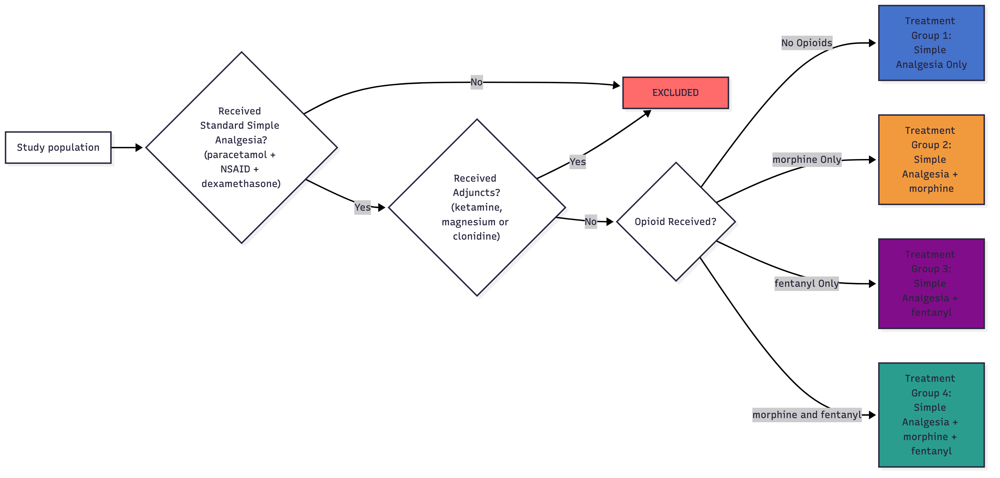

::: {.content-visible when-profile="website"}
# Manuscript
:::

```{r}
#| label: setup-manuscript
#| include: false

# Figures/tables are computed by the analysis stage (scripts/peri_op_med_analysis.qmd)
# and saved to data/main_objects.rds. Each labelled chunk below prints one of them with
# show_float(), which also saves a copy named after the label into export/.
source(here::here("scripts", "export_helpers.R"))
main <- load_objects("main")

# Dataset (df, adults, paeds), fitted models and formatters for inline results
source(here::here("scripts", "inline_helpers.R"))
```

## Background

Tonsillectomy and adenoidectomy are high-volume surgical procedures.  In the UK nearly 30,000 tonsillectomies are performed each year, typically for managing recurrent tonsillitis and/or sleep disordered breathing.[@reidReturnTheatrePosttonsillectomy2025; @ENTUKTonsillectomy] Procedures may be undertaken in combination (adenotonsillectomy) or isolation, depending on the indication, and most are day case procedures.

After tonsillectomy, severe postoperative pain is common. @gerbershagenPainIntensityFirst2013 Severe pain in the immediate postoperative period is distressing, delays discharge from hospital and increases healthcare costs.  Severe pain after discharge reduces oral intake and increase nausea and vomiting, reducing mechanical debridement of the fibrinous exudate in the tonsillar fossa and increasing the risk of infection and secondary bleeding.  Poorly controlled pain, postoperative infection and secondary bleeding are the leading causes of representation to primary care and emergency departments.[@ovesenPainBleedingAre2012; @tolskaSystematicReviewAnalgesics2019]

A recent systematic literature review and meta-analysis by the PROSPECT group generated nine recommendations for pain management across the perioperative period. @aldamlujiPROSPECTGuidelineTonsillectomy2021 Pre- and intraoperative recommendations are treatment with paracetamol, a non-steroidal anti-inflammatory (NSAID) drug, and dexamethasone.  The group recommend the addition of a non-opioid analgesic (ketamine, Gabapentinoid, or dexmedetomidine), where there was a contraindication to the basic analgesic regimen described.  Several studies examined the intraoperative use of tramadol; however, the authors were unable to reach a recommendation for its use due to a lack of available safety data.  Recommendations regarding the perioperative use of opioid medications were confined to a suggestion that they should be reserved as rescue agents in the immediate postoperative period, however the authors note a lack of available evidence regarding the effectiveness and safety profile of opioid medications in the intra- and postoperative periods.

Despite the large volume of these procedures undertaken, there remains little data as to the optimal intraoperative analgesic regimen, the comparative effectiveness of different strategies in general, and different approaches to intraoperative opioid use in particular.  The increasing availability of routinely collected patient data from electronic patient records (EPR) offers an opportunity to assess perioperative analgesic strategies at scale.  Patient, surgical and anaesthetic variables relevant to perioperative pain can now be accessed and incorporated in greater detail than previously possible.  In this study we aimed to use routinely collected EPR data to map analgesic practices for adults and children undergoing tonsillectomy and adenotonsillectomy and describe existing variation in practice and explore associations between analgesic strategies and postoperative outcomes, thus contributing evidence of existing practices and to generate hypotheses to inform future research.   


## Methods

### Design, Setting and Population

A single centre, retrospective electronic patient record (EPR) cohort study.  Patients who underwent elective tonsillectomy, adenoidectomy, or combined adenotonsillectomy were included.  Procedures were identified using relevant OPCS Classification of Interventions and Procedures codes (@sec-sm-data-spec-procedures).  

Data from the Epic (Epic Systems, Wisconsin) EPR for University College London Hospitals NHS Foundation Trust (UCLH), including The Royal National Throat, Nose and Ear Hospital were evaluated.  All patients who admitted for surgery between `r paste0(ordinal(day(min(df$Date))), " ", month(min(df$Date), label = TRUE, abbr = FALSE), ", ", year(min(df$Date)))` and `r paste0(ordinal(day(max(df$Date))), " ", month(max(df$Date), label = TRUE, abbr = FALSE), ", ", year(max(df$Date)))` were included.  Data analysis was undertaken using Python (v3.11.13) and `r version$version.string` @RProgram with scripts and packages provided in @sec-sm-analysis-code.  
  
### Data Specification

#### Patient and Surgical Factors

Using International Classification of Diseases (10) codes, indicators of relevant medical conditions were extracted from the patient’s active medical problem list at the time of the surgical encounter.  These included indicators of chronic pain states, preoperative opioid dependence, history of recurrent tonsillitis, sleep disordered breathing or obstructive sleep apnoea (@sec-sm-data-spec-pmh). Patients were grouped into adult (≥ 18 years) and paediatric (< 18 years) cohorts based on age on admission to hospital.  

#### Perioperative Analgesic Exposure

Analgesic medication administration was identified from EPR timestamps within both preoperative medication and intraoperative anaesthetic records.  Simple analgesics were defined as paracetamol, any selective or non-selective COX inhibitors and dexamethasone. Opioid medications included morphine, fentanyl, oxycodone, diamorphine or tramadol.  Intraoperative use of remifentanil infusions were excluded due to their limited role in postoperative analgesia.  Non-opioid analgesics examined included clonidine, ketamine and magnesium.  Dexmedetomidine is not routinely used at UCLH perioperatively. 
For each medication, route of administration and dose were extracted across three phases of care: 1) Preoperatively – four hours before procedure start, 2) Intraoperatively – start of anaesthesia to end of procedure, and 3) Postoperatively – from entry into recovery area to time of hospital discharge. Combined opioid dosing was calculated using oral morphine equivalents (OME, milligrams) using standard methods (@sec-sm-analysis-code).  For paediatric patients, doses were adjusted for weight and presented as milligrams per kilogram (mg kg$^{-1}$).

#### Intraoperative Analgesic Strategy

To explore the prevalence and effectiveness of different analgesic strategies and the perioperative use of opioids, four clinically relevant treatment groups were predefined (@fig-mermaid-groups).  Group 1 represents a simple analgesic strategy without opioids (in line with current PROSPECT guidance) and includes patients administered paracetamol during the pre or intraoperative phases), a NSAID and dexamethasone.  Group 2 and 3 include patients receiving simple analgesia plus an intraoperative opioid (morphine or fentanyl respectively).  Group 4 represents patients who received simple analgesia with both morphine and fentanyl intraoperatively.  Patients receiving non-opioid analgesics (clonidine, ketamine, magnesium) were analysed separately.  

{#fig-mermaid-groups}

### Outcome Measures

The primary outcome measure was rescue opioid medication, defined as the administration of any opioid drug within three hours of the end of the procedure and recording dose and frequency of administration.  This was chosen as a quantitative measure of intraoperative analgesic effectiveness during the immediate postoperative period.  A sensitivity analysis was conducted to assess different time cut-offs for opioid administration within the initial recovery period (@sec-sm-sensitivity-opioid).
Secondary outcomes were chosen to reflect a range of process and effectiveness measures directly relevant to tonsillectomy patients.  These were: time spent in first-stage recovery (a key determinant of patient flow for day case procedures and influenced by over or under administration of analgesia) and numerical pain score at rest (0-4) for the first three postoperative hours.  Length of hospital admission was calculated from day of procedure to hospital discharge.  The number and details of opioid prescriptions for postoperative analgesia on hospital discharge were extracted and grouped into ‘weak’ or ‘strong’ opioids as per World Health Organisation definitions (@sec-sm-data-spec-discharge).  Data pertaining to return to theatre and re-presentation to the UCLH emergency department within 7, 14 and 30 postoperative days and in-hospital, 30 day and one year mortality were also reported where available.

### Statistical Analysis

The variables listed were described using absolute numbers (percentages) for categorical variables, parametrically distributed variables are shown as means (standard deviations and medians (interquartile ranges) are presented for non-parametric variables.  Descriptions for analgesic exposure, perioperative analgesic strategy and outcome variables are presented, stratified by adult and paediatric cohorts, and surgical subgroups.
Multilevel modelling was used to investigate the association between analgesic strategy the primary and secondary outcomes, accounting for clinically relevant co-variants selected using expert domain knowledge and directed acyclic graphs (@sec-sm-modelling-dag).  Models were constructed for each outcome measure, with anaesthetic consultant identity incorporated as a random effect.  Where the anaesthetic consultant identifier was not associated with five or more cases, these were excluded following a sensitivity analysis (@sec-sm-sensitivity-group-size).  

## Results

### Study Population

`r comma(nrow(df))` patients had a surgical encounter matching the predefined OPCS codes during the study period.  @tbl-demo-all shows the demographics of both adult and paediatric cohorts.  

<!-- INSERT: tbl-demo-all -->

```{r}
#| label: tbl-demo-all
#| tbl-cap: "**Demographics table - All patients.** Participant baseline demographics and clinical history stratified by adult and paediatric cohorts. Categorical data as number (%). IQR (Interquartile Range), EPR (Electronic Patient Record). Missing data count and proportion of total cohort presented"

show_float(main)
```

Isolated tonsillectomy was the most common procedure in the adult cohort (n = `r N(adults$cohort == "Tonsillectomy")`, `r P(adults$cohort == "Tonsillectomy")`; @tbl-demo-adult), whilst paediatric patients predominantly underwent adenotonsillectomy (n = `r N(paeds$cohort == "Adenotonsillectomy")`, `r P(paeds$cohort == "Adenotonsillectomy")`; @stbl-demo-paed).  

<!-- INSERT: tbl-demo-adult -->

```{r}
#| label: tbl-demo-adult
#| tbl-cap: "**Demographics table - Adult patients.** Participant and surgical data for adult cohort stratified by surgical procedure group. Categorical data as number (%). IQR (Interquartile Range), EPR (Electronic Patient Record)."

show_float(main)
```

Across all surgical procedures, `r comma(df %>%filter(adult == 1) %>% with(sum(hx_chronic_tonsillitis == TRUE, na.rm = TRUE)))` (`r percent(df %>%filter(adult == 1) %>% with(sum(hx_chronic_tonsillitis == TRUE, na.rm = TRUE))/nrow(df%>%filter(adult==1)), 0.1)`) adults and `r comma(df %>%filter(adult == 0) %>% with(sum(hx_chronic_tonsillitis == TRUE, na.rm = TRUE)))` (`r percent(df %>%filter(adult == 0) %>% with(sum(hx_chronic_tonsillitis == TRUE, na.rm = TRUE))/nrow(df%>%filter(adult==0)), 0.1)`) children had an EPR diagnosis of chronic tonsillitis.  A diagnosis of OSA was recorded in `r comma(df %>%filter(adult == 1) %>% with(sum(hx_sleep_apnoea == TRUE, na.rm = TRUE)))` (`r percent(df %>%filter(adult == 1) %>% with(sum(hx_sleep_apnoea == TRUE, na.rm = TRUE))/nrow(df%>%filter(adult==1)), 0.1)`) adults and `r comma(df %>%filter(adult == 0) %>% with(sum(hx_sleep_apnoea == TRUE, na.rm = TRUE)))` (`r percent(df %>%filter(adult == 0) %>% with(sum(hx_sleep_apnoea == TRUE, na.rm = TRUE))/nrow(df%>%filter(adult==0)), 0.1)`) children.  
There was less Coblation use recorded in adult patients compared with children (n = `r comma(df %>%filter(adult == 1) %>% with(sum(coblation == TRUE, na.rm = TRUE)))` (`r percent(df %>%filter(adult == 1) %>% with(sum(coblation == TRUE, na.rm = TRUE))/nrow(df%>%filter(adult==1)), 0.1)`) and n = `r comma(df %>%filter(adult == 0) %>% with(sum(coblation == TRUE, na.rm = TRUE)))` (`r percent(df %>%filter(adult == 0) %>% with(sum(coblation == TRUE, na.rm = TRUE))/nrow(df%>%filter(adult==0)), 0.1)`) respectively).

### Analgesic Exposure

All intraoperative analgesic administration is shown in @tbl-analgesic-adult (adult) and @stbl-analgesic-paed (paediatric) for each surgical procedure group.

<!-- INSERT: tbl-analgesic-adult -->

```{r}
#| label: tbl-analgesic-adult
#| tbl-cap: "**Anaesthetic management - Adults.** Intraoperative analgesia administration for adult patients stratified by surgical group. OME, Oral Morphine Equivalent."

show_float(main)
```

#### Simple Analgesia – Paracetamol, NSAID, Dexamethasone

Across the adult population, `r P(adults$simple_analgesia_given)` (n = `r N(adults$simple_analgesia_given)`) of patients received a standard simple analgesia combination of paracetamol, diclofenac and dexamethasone (@fig-venn-adult (A)).  Of those that did not receive all three medications, the most common omission was diclofenac (@fig-venn-adult (B)).  In the paediatric cohort `r P(paeds$simple_analgesia_given)` (n = `r N(paeds$simple_analgesia_given)`) of patients received complete simple analgesia (@sfig-venn-paed (A)).  
Paracetamol was given in `r P(paeds$intra_op_and_pre_paracetamol_given)` (n = `r N(paeds$intra_op_and_pre_paracetamol_given)`) of paediatric cases, of which `r P(paeds$pre_op_paracetamol_given)` (n = `r N(paeds$pre_op_paracetamol_given)`) was received as an oral dose prior to theatre (@sfig-venn-paed (B)).  Oral pre-dosing was not common in the adult cohort (`r P(adults$pre_op_paracetamol_given)`, n = `r N(adults$pre_op_paracetamol_given)`), but overall perioperative use was similarly high (`r P(adults$intra_op_and_pre_paracetamol_given)`, n = `r N(adults$intra_op_and_pre_paracetamol_given)`).  There was no use of selective COX-2 inhibitor drugs during the study period.

<!-- INSERT: fig-venn-adult -->

```{r}
#| label: fig-venn-adult
#| fig-cap: "**Venn diagrams of adult intraoperative medications.** Distributions of complete intra-operative simple analgesia and intraoperative opioid administration in adults (A). Venn diagram to show the breakdown of the simple analgesia (B) and opioids given (C)"
#| fig-alt: "Venn diagrams of adult intraoperative medications"
#| fig-width: 18
#| fig-height: 12

show_float(main, width = 12, height = 8, scale = 1.5)
```

#### Opioid Analgesia

`r P(adults$intra_op_opioid_given)` (n = `r N(adults$intra_op_opioid_given)`) of adult patients and `r P(paeds$intra_op_opioid_given)` (n = `r N(paeds$intra_op_opioid_given)`) of paediatric patients received a strong opioid medication intraoperatively (@sec-sm-data-spec-intra-op-meds). @tbl-analgesic-adult  (adult) and @stbl-analgesic-paed (paediatric) show the breakdown of opioid medication use across each surgical procedure group.  
Across all procedures, a single opioid strategy with fentanyl was most common in children, accounting for `r P(fent_only(paeds))` of cases (n = `r N(fent_only(paeds))`; @sfig-venn-paed C).  Adults received a mix of strategies, with `r P(fent_only(adults))` (n = `r N(fent_only(adults))`) receiving fentanyl only, `r P(morph_only(adults))` (n = `r N(morph_only(adults))`) morphine only, `r P(both_opioids(adults))` (n = `r N(both_opioids(adults))`) receiving both and `r P(no_opioids(adults))` (n = `r N(no_opioids(adults))`) receiving neither, illustrated in @fig-venn-adult C).  The median intraoperative opioid dose administered to adults was `r med(adults$intra_op_ome, 0)`mg (OME, IQR = `r q1(adults$intra_op_ome, 0)`-`r q3(adults$intra_op_ome, 0)`mg). Patients receiving a regimen of simple analgesia plus morphine only received a median `r med(adult_group[[2]]$intra_op_ome, 0)`mg OME (IQR `r q1(adult_group[[2]]$intra_op_ome, 0)`-`r q3(adult_group[[2]]$intra_op_ome, 0)`mg), contrasting with `r med(adult_group[[3]]$intra_op_ome, 0)`mg OME (IQR `r q1(adult_group[[3]]$intra_op_ome, 0)`-`r q3(adult_group[[3]]$intra_op_ome, 0)`mg) in fentanyl only group, and `r med(adult_group[[4]]$intra_op_ome, 0)`mg (IQR `r q1(adult_group[[4]]$intra_op_ome, 0)`-`r q3(adult_group[[4]]$intra_op_ome, 0)`mg) in the combined opioid group (@sfig-opioid-histogram-adult).
Paediatric patients received a median fentanyl dose of `r med(paeds$intra_op_fentanyl_dose_per_kg, 2)` mcg.kg$^{-1}$ (IQR = `r q1(paeds$intra_op_fentanyl_dose_per_kg, 2)` – `r q3(paeds$intra_op_fentanyl_dose_per_kg, 2)` mcg.kg$^{-1}$) and a median morphine dose of `r med(paeds$intra_op_morphine_sulfate_dose_per_kg, 2)` mg.kg$^{-1}$ (IQR = `r q1(paeds$intra_op_morphine_sulfate_dose_per_kg, 2)` – `r q3(paeds$intra_op_morphine_sulfate_dose_per_kg, 2)` mg.kg$^{-1}$).

No patients received oxycodone, diamorphine or tramadol intraoperatively.

#### Non-Opioid Analgesics – Clonidine, Ketamine, Magnesium

The use of non-opioid analgesics was generally low across both adult and paediatric cohorts (@sfig-venn-adjuncts).  `r P(df$intra_op_non_opioid_given)` (n = `r N(df$intra_op_non_opioid_given)`) of patients received either clonidine, ketamine and or magnesium. Clonidine was used in `r P(adults$intra_op_clonidine_given)` (n = `r N(adults$intra_op_clonidine_given)`) of adult cases and `r P(paeds$intra_op_clonidine_given)` (n = `r N(paeds$intra_op_clonidine_given)`) of paediatric cases, whilst ketamine was used in `r P(adults$intra_op_ketamine_given)` (n = `r N(adults$intra_op_ketamine_given)`) of adult cases and `r P(paeds$intra_op_ketamine_given)` (n = `r N(paeds$intra_op_ketamine_given)`) of paediatric cases. Magnesium was used in `r P(adults$intra_op_magnesium_given)` (n = `r N(adults$intra_op_magnesium_given)`) adult cases and `r P(paeds$intra_op_magnesium_given)` (n = `r N(paeds$intra_op_magnesium_given)`) paediatric cases. 

#### Combined Analgesic Strategies

Across the adult cohort, the most common analgesic combination seen was Group 3 (n = `r N(adults$treatment_arm == 3)`, `r P(adults$treatment_arm == 3)` of all adult patients), followed by Group 2 (n = `r N(adults$treatment_arm == 2)`, `r P(adults$treatment_arm == 2)`) and Group 4 (n = `r N(adults$treatment_arm == 4)`, `r P(adults$treatment_arm == 4)`)(@tbl-analgesic-adult). @fig-upset-adult shows the relative distribution of the different possible combinations of intraoperative analgesic agents.

<!-- INSERT: fig-upset-adult -->

```{r}
#| label: fig-upset-adult
#| fig-cap: "**UpSet graph of the combinations of adult intraoperative analgesia.** Distribution of the different analgesic combinations for adults patients. Upper vertical bar graph showing the total count of each combination of analgesia with treatment groups coloured. Lower left horizontal bar graph showing the total count of patients receiving each specific medication."
#| fig-alt: "UpSet graph of the combinations of adult intraoperative analgesia"

show_float(main)
```

Across the paediatric cohort less heterogeneity in the analgesic combinations was observed (@sfig-upset-paed).  The commonest strategy was Group 3 (n = `r N(paeds$treatment_arm == 3)`, `r P(paeds$treatment_arm == 3)`), followed by Group 4 (n = `r N(paeds$treatment_arm == 4)`, `r P(paeds$treatment_arm == 4)`).  `r P(paeds$simple_analgesia_given == 0)` (n = `r N(paeds$simple_analgesia_given == 0)`) of the paediatric cohort did not receive a complete combination of simple analgesia (paracetamol, NSAID and dexamethasone).

### Outcomes

Across all surgical procedure groups, `r P(adults$opioid_given_post_op)` (n = `r N(adults$opioid_given_post_op)`) of adult patients required rescue opioid administration in the first three postoperative hours, compared to `r P(paeds$opioid_given_post_op)` (n = `r N(paeds$opioid_given_post_op)`) of children. In adults, the median dose of rescue opioid administered was `r med(adults$ome_post_op, 0)`mg (OME, IQR = `r q1(adults$ome_post_op, 1)`-`r q3(adults$ome_post_op, 0)`mg), of which `r P(adults$opioid_given_post_op_fentanyl, n_true(adults$opioid_given_post_op), 1)` was administered as fentanyl (n = `r N(adults$opioid_given_post_op_fentanyl)`).  The breakdown of administration across each surgical procedure group and secondary outcome measures are shown in @tbl-outcome-adult (adult) and @stbl-outcome-paed (paediatric).

<!-- INSERT: tbl-outcome-adult -->

```{r}
#| label: tbl-outcome-adult
#| tbl-cap: "**Adult outcomes.** Outcome data for adult patients stratified by surgical group. Return to theatre at UCLH and representation to UCLH emergency department only, cumulative measures at each time point. Eligible medications for discharge measured as classified in @sec-sm-data-spec."

show_float(main)
```


Adults spent a median `r med(adults$recovery_time)` minutes (IQR = `r q1(adults$recovery_time)` – `r q3(adults$recovery_time)` minutes) in first stage recovery, with `r P(adults$same_day_discharge)` (n = `r N(adults$same_day_discharge)`) going to be discharged home the same day.  The median length of stay from admission to hospital discharge was `r med(adults$length_of_admission, 2)` days (IQR = `r q1(adults$length_of_admission, 2)`-`r q3(adults$length_of_admission, 2)`).  Most adults (`r P(adults$weak_opioid_on_discharge)`, n = `r N(adults$weak_opioid_on_discharge)`) received a weak opioid prescription on discharge.  `r N(adults$opioid_on_discharge)` (`r P(adults$opioid_on_discharge)`) adult patients received a strong opioid prescription on discharge, all of which were continuations of an existing preoperative opioid prescription.  There were no newly initiated strong opioid prescriptions.
Children spent a median `r med(paeds$recovery_time)` minutes (IQR = `r q1(paeds$recovery_time)` – `r q3(paeds$recovery_time)` minutes) in first stage recovery, with `r P(paeds$same_day_discharge)` (n = `r N(paeds$same_day_discharge)`) going on to be discharged the same day.   `r P(paeds$paracetamol_on_discharge)` (n = `r N(paeds$paracetamol_on_discharge)`) were discharged with paracetamol, `r P(paeds$nsaid_on_discharge)` (n = `r N(paeds$nsaid_on_discharge)`) with an NSAID, with `r N(paeds$weak_opioid_on_discharge)` (`r P(paeds$weak_opioid_on_discharge)`) receiving a weak opioid prescription and `r N(paeds$opioid_on_discharge)` (`r P(paeds$opioid_on_discharge)`) receiving a strong opioid prescription; of which all were a continuation of a pre-admission strong opioid.    
Rates of return to theatre were low with `r P(adults$return_to_theatre_30d)` (n = `r N(adults$return_to_theatre_30d)`) of adults and `r P(paeds$return_to_theatre_30d)` (n = `r N(paeds$return_to_theatre_30d)`) paediatric cases returning within 30 days.  `r N(adults$died)` adult patient died during the surgical encounter.
Across the whole study sample, the representation rate to the study centre’s emergency department (ED) within 30 days was `r P(df$ed_visit_in_30d)` (n = `r N(df$ed_visit_in_30d)`), `r P(adults$ed_visit_in_30d)` (n = `r N(adults$ed_visit_in_30d)`) in adults and `r P(paeds$ed_visit_in_30d)` (n = `r N(paeds$ed_visit_in_30d)`) in children.  A manual review of 50 randomly selected cases representing to the ED showed that 52% (n =26) were related to bleeding, 38% (n = 19) related to pain control, 4% (n = 2) with symptoms of infection.  Three patients represented for reasons unrelated to surgery.  Of the 50 cases reviewed, 55% (n = 26) were admitted to hospital for further treatment.  

### Association of Analgesic Strategy with Outcomes

For the primary outcome measure, unadjusted (rescue analgesia and analgesic group) and adjusted models (incorporating clinically relevant covariates as fixed effects) are presented.  @sfig-consort-modelling shows the composition of adult and paediatric cohorts used for model construction and the distribution of the associated treatment groups.  Given the lack of observed variation in the analgesic and opioid practices for the paediatric cohort, this analysis was confined to the adult cohort. 

#### Adults

After applying exclusion criteria, `r comma(nobs(mod(1)))` patients were included in the analysis.  The most common analgesic group was 3 (n = `r N(model_frame(1)$treatment_arm == 3)`, `r P(model_frame(1)$treatment_arm == 3)`), followed by 2 (n = `r N(model_frame(1)$treatment_arm == 2)`, `r P(model_frame(1)$treatment_arm == 2)`), 4 (n = `r N(model_frame(1)$treatment_arm == 4)`, `r P(model_frame(1)$treatment_arm == 4)`) and 1 (n = `r N(model_frame(1)$treatment_arm == 1)`, `r P(model_frame(1)$treatment_arm == 1)`).  
An unadjusted generalised linear mixed effects model (model 1) examining the association of rescue opioid administration with analgesic group (using group 1 as a reference) and nested by anaesthetic consultant identity demonstrated a `r ref_prob(1)` chance of receiving rescue opioids in recovery for patients who did not receive any intraoperative opioid (group 1).  Group 4 (simple analgesia plus morphine and fentanyl) demonstrated a significant negative association (OR `r or_est(1, "treatment_arm4")`, 95% CI `r or_lo(1, "treatment_arm4")`-`r or_hi(1, "treatment_arm4")`).  Anaesthetist identity accounted for `r re_var(1)` (SD `r re_sd(1)`) of the observed variation in the unadjusted model.  
After adjusting for age, sex, surgical procedure type, ASA, chronic pain history, procedure length, use of a Coblation technique and intraoperative opioid dose (model 2), the association observed for Group 4 was no longer significant (OR `r or_est(2, "treatment_arm4")`, 95% CI `r or_lo(2, "treatment_arm4")`-`r or_hi(2, "treatment_arm4")`).  Variation associated with the individual anaesthetist was `r re_var(2)` (SD `r re_sd(2)`).

The same model parameters were used to evaluate the secondary outcomes (@sfig-forrest-plot). Treatment group 4 showed a reduced time in recovery (`r beta(3, "treatment_arm4")` minutes, 95% CI `r beta(3, "treatment_arm4", "conf.low")` to `r beta(3, "treatment_arm4", "conf.high")`) and an increased, but not significant, odds ratio of `r or_est(4, "treatment_arm4")` of same day discharge (95% CI `r or_lo(4, "treatment_arm4")` to `r or_hi(4, "treatment_arm4")`).  Modelling of pain scores was not possible due to the lack of distribution in data and the model of presentations to the emergency department was non-significant with low confidence (@sec-sm-modelling). 

## Discussion

This single-centre, retrospective EPR cohort study investigated the intraoperative use of opioid medications in adult and paediatric patients undergoing tonsillectomy and adenotonsillectomy.  Using routinely collected electronic patient data for `r comma(nrow(df))` patients we were able to examine patient, surgical and anaesthetic variables relating to perioperative analgesic management and intraoperative opioid administration.  The majority of patients (`r P(df$simple_analgesia_given)`, n = `r N(df$simple_analgesia_given)`) received the combination of simple analgesia recommended by the current PROSPECT guidelines (paracetamol, NSAID, and dexamethasone).  Additionally, `r P(df$intra_op_opioid_given)` of adults and children received an intraoperative opioid medication.  In children, most (`r P(fent_only(paeds))`, n = `r N(fent_only(paeds))`) received a single opioid regimen of fentanyl, at a median dose of `r med(paeds$intra_op_fentanyl_dose_per_kg, 2)` mcg.kg$^{-1}$ (IQR `r q1(paeds$intra_op_fentanyl_dose_per_kg, 2)`-`r q3(paeds$intra_op_fentanyl_dose_per_kg, 2)` mcg.kg$^{-1}$).  Opioid strategies in adults were less uniform, with `r P(fent_only(adults))` (n = `r N(fent_only(adults))`) receiving a fentanyl-only strategy, `r P(morph_only(adults))` (n = `r N(morph_only(adults))`) receiving morphine only, and `r P(both_opioids(adults))` (n = `r N(both_opioids(adults))`) receiving both.

To investigate the association between opioid technique and immediate postoperative outcomes, patients were categorised into one of four treatment groups based on the receipt of full simple analgesia, simple analgesia plus a single opioid (fentanyl or morphine) and simple analgesia plus both opioid medications.  Patients who received additional non-opioid analgesia were excluded.  Due to the lack of opioid variation in the paediatric cohort this analysis was confined to adults.  Patients in the combined opioid group received a higher median dose (`r med(adult_group[[4]]$intra_op_ome, 0)`mg vs. `r med(adult_group[[3]]$intra_op_ome, 0)`mg vs. `r med(adult_group[[2]]$intra_op_ome, 0)`mg OME) compared with the morphine and fentanyl-only groups respectively, indicating clinicians had different dosing strategies in addition to opioid preferences.  

Multilevel modelling, accounting for the individual anaesthetic consultant and adjusting for a range of clinically relevant patient, surgical and anaesthetic covariates revealed no statistically significant association between type of opioid and receipt of rescue analgesia in the first three postoperative hours compared to the simple analgesia only group.  However, the fentanyl-only (`r beta(3, "treatment_arm3", flip = TRUE)` minutes 95% CI `r beta(3, "treatment_arm3", "conf.high", flip = TRUE)` – `r beta(3, "treatment_arm3", "conf.low", flip = TRUE)`) and combined opioid groups (`r beta(3, "treatment_arm4", flip = TRUE)` minutes, 95% CI `r beta(3, "treatment_arm4", "conf.high", flip = TRUE)` – `r beta(3, "treatment_arm4", "conf.low", flip = TRUE)`) were associated with less time in recovery. In addition, the morphine only group was associated with better odds of being discharged home on the day of surgery (Group 2 OR `r or_est(4, "treatment_arm2")`, `r or_lo(4, "treatment_arm2")`-`r or_hi(4, "treatment_arm2")`), potentially suggesting that fentanyl is effective in the short-term, but a morphine-containing opioid strategy may have benefits extending beyond the initial recovery period.
Intraoperative opioid treatment group was not associated with chance of receiving a strong opioid prescription on discharge from hospital, or representation to the hospitals’ ED in the first seven postoperative days.  Given that tonsillectomy and adenotonsillectomy are associated with high rates of representation compared with other day case procedures @powellTonsillectomyComplicationsAdults2026, this suggests intraoperative opioid strategy is unlikely to influence pain control in the days following surgery.

In general, there is a lack of evidence supporting the optimal intraoperative analgesic strategy for both and adult and paediatric tonsillectomy.  Most focuses on the safety and effectiveness of postoperative analgesia, or the evaluation of specific intraoperative agents and techniques, such as intracapsular drug infiltration[@dalEfficacyIntravenousPeritonsillar2007; @teunkensBupivacaineInfiltrationChildren2019; @akkayaComparisonIntravenousPeritonsillar2009], or intravenous methadone. @bondergaardmIntraoperativeMethadonePostoperative2025  Whilst the prevailing zeitgeist appears to be towards opioid minimisation, or opioid free techniques, responding to concerns around side effects such as postoperative nausea and vomiting, sedation, or tolerance and hyperalgesia associated with ultra-short acting agents like remifentanil, there remains little evidence of what is most effective. @shanthannaPerioperativeOpioidAdministration2021  Our findings suggest that anaesthetists in both adult and paediatric routinely use opioids intraoperatively, but there is variation in how these medications are used, particularly in adults.  

Bøndergaard and colleagues examined the effectiveness of intravenous methadone (24-48 hour half-life) versus 3 mcg.kg$^{-1}$ fentanyl administered on induction of anaesthesia.  Their randomised trial of 120 adult patients undergoing elective bilateral tonsillectomy revealed lower immediate postoperative opioid requirements across the first five postoperative days.  There were no between group differences in sedation or time to discharge, however the methadone group was associated with significantly higher rates of postoperative nausea and vomiting. @bondergaardmIntraoperativeMethadonePostoperative2025  We found no studies directly comparing the effectiveness and safety of intraoperative morphine and fentanyl regimens in adult patients.  Given these are the two most commonly used intraoperative opioid analgesic agents in the UK (excluding the use of remifentanil for its lack of postoperative analgesic benefit), it would make sense to identify the optimal treatment choice here.  Our study results raise the interesting question as to the potential superiority of a dual analgesic approach, combining both fentanyl and morphine.  In a recent large study by Santa Cruz Mercardo et al, higher intraoperative opioid administration was also associated with lower immediate and long term opioid use postoperatively. @santacruzmercadoAssociationIntraoperativeOpioid2023

This dual approach might harness the relative differences in time taken to reach peak effect site concentration for each agent (fentanyl: rapid onset of action, duration of effect 30-45min; morphine: 15-30min onset time, 4-6 hour duration of action).  Fentanyl is frequently used as a co-induction agent, to facilitate airway placement and blunt the initial response to surgery, with morphine being delivered later during the procedure to provide both intra- and postoperative analgesia.  This rational should apply equally to the combined use of remifentanil and morphine, which may have been captured in Treatment Group 2.  It is possible that the difference in effect observed between groups 2 and 4 might relate to use of remifentanil, resulting in postoperative hyperalgesia.  The benefit of an intraoperative opioid strategy which incorporates this concept of pharmacokinetic layering has, to the authors’ knowledge, yet to be examined in this surgical group.

Our study has several strengths.  We have demonstrated the practicality of using a data ecosystem and study pipeline specifically designed to reduce the barriers to using highly granular, routinely collected electronic patient data to map current and historical practice and address specific questions around care variation and treatment effectiveness.  This pipeline is sustainable and will support repeated analyses as the eligible population continues to grow over time.  

By using structured EPR data, we have been able to include variables relevant to perioperative analgesic management, but which are often difficult to include in observational studies of this type.  These include patient (pre-existing chronic pain or opioid use), surgical (procedure length, use of Coblation technique) and anaesthetic (intra- and postoperative analgesic use) specific variables.  By incorporating these with the individual anaesthetist’s preferences using a multilevel modelling approach, we can move closer to a fuller picture of clinical decision making for smaller patient subgroups.  Finally, the application of these principles to a large dataset of over 3,000 patients may help address some of the deficiencies inherent to a retrospective observational approach.

There are important limitations to this study.  This is a single centre study and despite the relatively large sample size compared with similar work, this limits the generalisability of our findings.  EPR-based studies are at high risk of bias through several mechanisms.  Despite capturing relevant variables in greater detail than previously possible in similar work 7, there remain key components missing.  In particular, patient data such as ethnicity was associated with a significant degree of missingness (@sec-sm-missing-data).  In addition, it was not possible to reliably determine anaesthetic technique, in particular, discerning between volatile and total intravenous techniques, which may significantly influence both the intraoperative opioid administration practice and postoperative recovery.  Finally, whilst the use of Coblation was reliably coded via a specific procedure code (@sec-sm-data-spec-procedures), alternative surgical approaches such as blunt dissection, or diathermy were not coded, existing only as unstructured data within the operation record.  Further, there are additional variables relating to surgical technique which are also unstructured and were not included in the analysis, such as the extent of surgical dissection (intra versus extra-capsular), which will also influence postoperative pain and recovery, a limitation noted in previous studies. @keltiePaediatricTonsillectomyEngland2021  

Given the lack of accounting for unmeasured confounding using a multilevel modelling approach, we make no causal judgements on the associations described.  We also acknowledge limitations in our outcome measures, in particular the imposition of a 3-hour time cut for rescue opioid administration, given there is no defined transition point between phases of recovery.  A sensitivity analysis exploring different time cut-offs for defining rescue opioid administration can be found in @sec-sm-sensitivity-opioid.  Further, we were only able to capture re-presentation to the study centres’ ED.  Reported figures are therefore likely an underestimate as they do not reflect patients presenting to other hospitals or primary care. 
Future work should focus on addressing these limitations.  In particular, improving quality of intraoperative and outcome data as described.  Given the subjective nature of both pain descriptors and recovery from surgery, patient reported outcome measures should also be defined and incorporated into future analyses.  The lack of clear answer on optimal intraoperative analgesic technique should also form the basis of future randomised trials going forward.

In conclusion, adult and paediatric tonsillectomy and adenotonsillectomy patients in this cohort study commonly received an intraoperative opioid, in the absence of evidence-based guidance on the optimal intraoperative opioid strategy.  Whilst opioid use in paediatric patients was uniform, adults showed greater variation, with a corresponding association to variation in immediate postoperative outcomes after correcting for key patient, surgical and anaesthetic variables.

