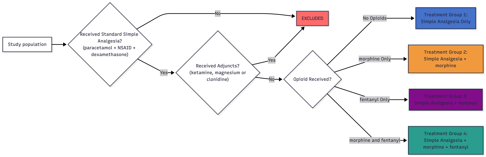
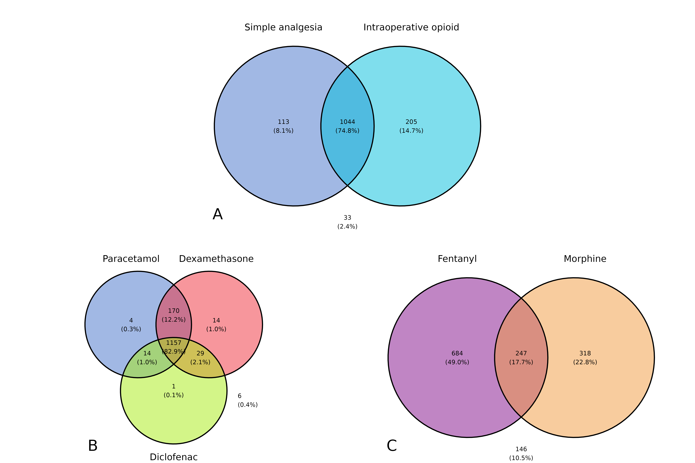
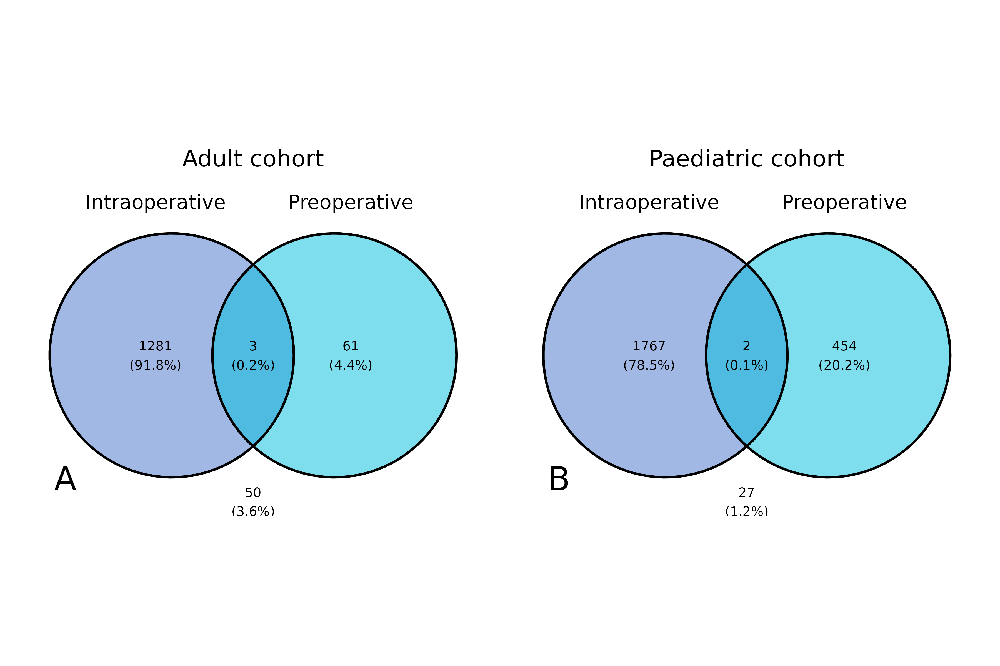
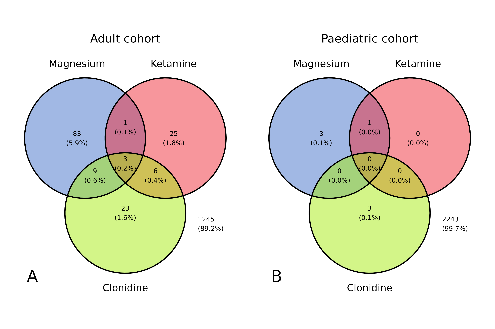
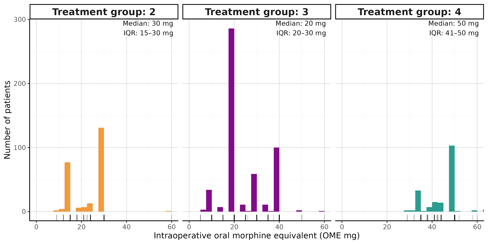
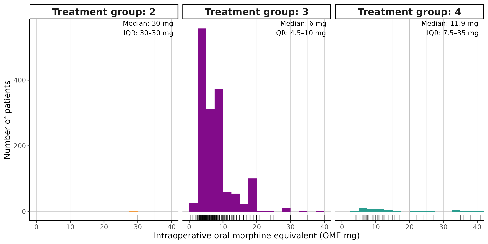
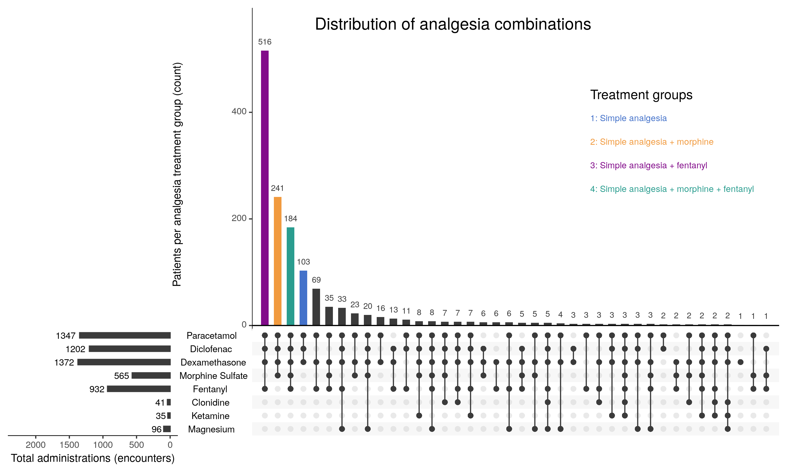
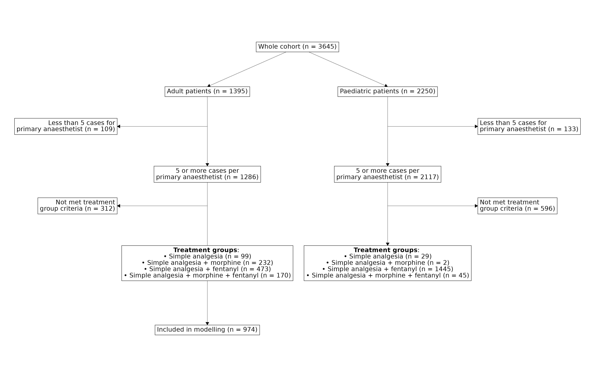
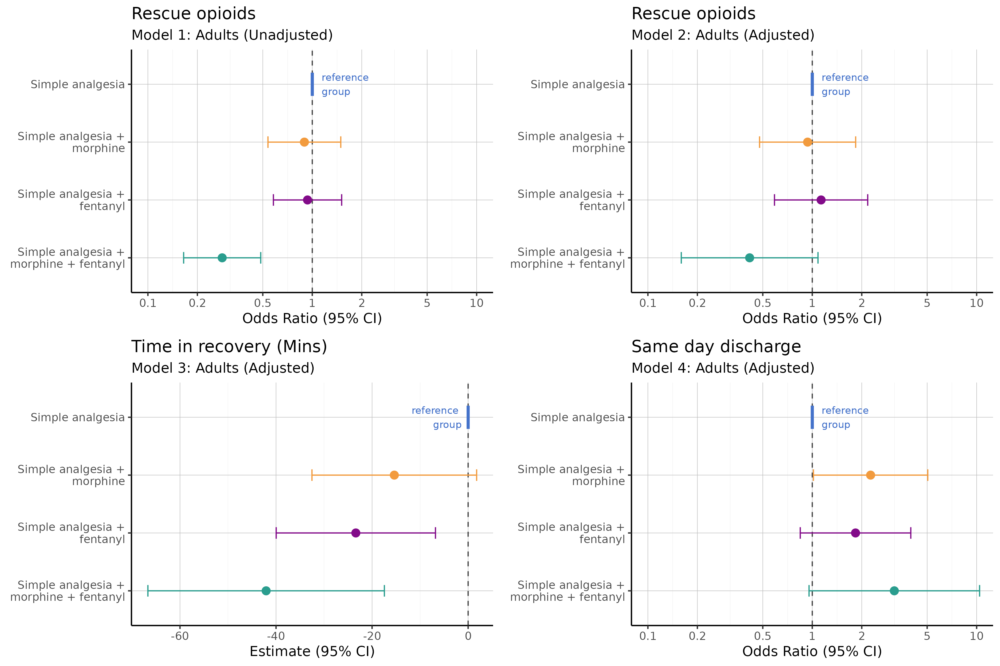

```{r set up}
library(dplyr)
library(ggvenn)
library(gt)
library(broom.mixed)
library(tidyverse)
library(finalfit)
library(tableHTML)
library(patchwork)
library(ggconsort)
library(arrow)
library(lme4)
library(ggpubr)

source("~/data/dwhitake/tonsillectomy_analgesia/scripts/settings.R")
sapply(functions_paths, source, verbose=FALSE)
df <- readRDS(file=paste0(root_path, "/data/dataset.rds"))


knitr::opts_chunk$set(echo = FALSE)
knitr::opts_chunk$set(message = FALSE)
knitr::opts_chunk$set(warning = FALSE)

```

```{r draw_table() functions}

draw_table <- function(dependant = "cohort",
                       explanatory,
                       cohort,
                       caption = "DEFAULT CAPTION",
                       na_include = TRUE,
                       cont="median",
                       output = "tableHTML",
                       data_set=df,
                       show_total_col = TRUE,
                       show_missing_totals = TRUE,
                       show_total_row = TRUE,
                       demographic_table = FALSE,
                       meds_table = FALSE,
                       outcome_table= FALSE
                       ){
  
  
  
  #Formatting of values prior analysis
  
data_set<- data_set %>% mutate(adult = factor(adult, levels=c(1, 0), labels = c("Adult cohort", "Paediatric cohort")))  

data_set<- data_set %>% mutate(died = factor(died, levels=c(TRUE, FALSE), labels = c("N (%)", 0)))  

data_set<- data_set %>% mutate(across(starts_with("hx_"),~if_else(. == TRUE, "Yes", "No"))) 
data_set<- data_set %>% mutate(across(starts_with("hx_"),~factor(., levels=c("Yes", "No"))))   
data_set<-data_set %>% mutate(across(ends_with("_given"),~factor(., levels=c(1, 0)))) 
data_set<-data_set %>% mutate(across(starts_with("mortality"),~factor(., levels=c(1, 0)))) 
data_set<-data_set %>% mutate(across(starts_with("ed_visit"),~factor(., levels=c(1, 0))))
data_set<-data_set %>% mutate(across(starts_with("return_to_theatre"),~factor(., levels=c(1, 0))))
data_set<-data_set %>% mutate(new_opioids_on_discharge = factor(new_opioids_on_discharge, levels=c(1, 0)))  
data_set<-data_set %>% mutate(across(starts_with("opioid_given"),~factor(., levels=c(TRUE, FALSE)))) 
data_set<-data_set %>% mutate(across(ends_with("on_discharge"),~factor(., levels=c(TRUE, FALSE)))) 
data_set<-data_set %>% mutate(across(starts_with("coblation"),~factor(., levels=c(TRUE, FALSE)))) 
data_set<-data_set %>% mutate(across(starts_with("electrocautery"),~factor(., levels=c(TRUE, FALSE)))) 
  
  #Number of digits to round to (1) mean/median, (2) standard deviation / interquartile range, (3) p-value, (4) count percentage, (5) weighted count.
  digits = c(2, 2, 3, 1, 0)
  
  if(cohort == "all"){
    data_set <- data_set
  }else if(cohort == "adult"){
    data_set <- data_set %>% filter(adult == "Adult cohort") 
  }else if(cohort == "paeds"){
    data_set <- data_set %>% filter(adult == "Paediatric cohort")  
  
    }else{
    cli_abort("Chort must be in the list of {.var all, adult, paeds}, you have used {.val {cohort}}")
  }
  

    table_1 <- data_set %>% summary_factorlist(dependant,
                                         explanatory,
                                         p=FALSE,
                                         total_col = TRUE, #Adds a new col for the totals across the rows
                                         add_col_totals = show_total_row, # Adds a new row at the top of the table for the total observations in each group
                                         cont=cont,
                                         digits = digits,
                                         na_include = FALSE, # Adds a new row for the NA values under the other catagories of catagroical only
                                         include_row_missing_col = show_missing_totals, #Produces the "Missing_N" column
                                         add_row_totals = TRUE, # Have to leave true and then remove later
                                         row_missing_colname = "Missing data", #Names the missing_n col
                                         include_row_totals_percent = TRUE,
                                         row_totals_colname = "tot_col"
                                         )
    
    #Then we remove the Observations columbs
    table_1 <- table_1 %>% select(-tot_col)
    
    
    if(show_missing_totals){
    table_1 <- table_1  %>% relocate("Missing data", .after = last_col())
    
    # Add the missing percents
    tot <- nrow(data_set)
    
    for(r in 2:nrow(table_1)){
      
      if(table_1$`Missing data`[r] == ""){
        next
      }else if(table_1$`Missing data`[r] == "0"){
        next
      }else{
        table_1$`Missing data`[r] <- paste0(table_1$`Missing data`[r], " (",round((as.numeric(table_1$`Missing data`[r])/tot)*100, digits = 1) , "%)")
      }
      
      
    }
  
    }
    
    if(!show_total_col){
      table_1 <- table_1 %>% select(-Total)
    }
    
    #Table specific formatting 
    
    if(demographic_table){
      table_1 <- table_1 %>% filter(levels != "No")
      table_1 <- table_1 %>% filter(levels != FALSE)
    }
    
    if(cohort == "adult"){
    row_max = 15
  }else if(cohort == "paeds"){
   row_max = 18
   } 
    
    
    if(meds_table){
      table_1 <- table_1 %>% filter(levels != 0 | label %in% c("treatment_arm")) 
      for (r in 1:row_max){
        table_1[r, "levels"] <- ifelse(table_1[r, "levels"]==1 , "N (%)",table_1[r, "levels"] )
      }
      
    }
    
    if(outcome_table){
      table_1 <- table_1 %>% filter(levels != 0)
      table_1 <- table_1 %>% filter(levels != FALSE | label %in% c("died", "same_day_discharge"))
      table_1$levels <- ifelse(table_1$levels==1, "N (%)",table_1$levels)
      table_1$levels <- ifelse(table_1$levels==TRUE & !table_1$label %in% c("died", "same_day_discharge"), "N (%)",table_1$levels)
    }
    
    
    
#table_1 <- df %>% summary_factorlist("cohort", explanatory, p=FALSE, na_include = TRUE)

matches <- match(table_1$label, col_name_lookup)
table_1$label[!is.na(matches)] <- names(col_name_lookup)[matches[!is.na(matches)]]

headers <- names(table_1) %>% case_match( "label" ~ "", .default = names(table_1)) 

headers <- headers %>% case_match( "levels" ~ "", .default = headers)

#Find the rows with a value in label and then add two for the two header cols

if(output == "tableHTML"){
row_numbers <- (which(nchar(table_1$label) != 0))+2

html_table <- tableHTML(table_1,
          rownames = FALSE,
          #widths = c(100,300, rep(75, (ncol(table_1)-2))),
          headers = headers,
          second_headers = list(c(2, 5, 1), c('', 'Cohort', '')),
          caption = caption,
          border = 1,
          collapse = 'collapse') %>%
  add_theme('scientific') %>% 
  add_css_row(css = list('background-color', '#f2f2f2'), rows = odd(3:(nrow(table_1)+2))) %>%
  add_css_column(css = list('text-align', 'left'), columns = c("label", "levels")) %>%
  add_css_row(css = list('border-top', '2px solid black'), rows = row_numbers) %>%
  add_css_column(css = list('border-left', '1px solid black'), columns = length(table_1))

return(html_table)

}else if(output == "gt"){
library(gt)
library(dplyr)
  
  row_numbers <- (which(nchar(table_1$label) != 0))

# Example: assume table_1 is a data frame and headers is a vector of column names
gt_table <- table_1 %>%
  gt() %>%
  # Apply custom headers
  cols_label(.list = setNames(headers, names(table_1))) %>%
  
  # Add second headers (column spanners)
#  tab_spanner(
#    label = "Cohort",
#    columns = if(show_total_col){c(4:6)}else{c(3:5)}   # adjust according to (2,5,1) grouping
#  ) %>%
  
  # Caption
 # tab_caption(caption) %>%
  
  # Odd row shading (like #f2f2f2)
  tab_style(
    style = list(cell_fill(color = "#f2f2f2")),
    locations = cells_body(
      rows = seq(2, nrow(table_1), 2) # shade every other row
    )
  ) %>%
  
  # Left align certain columns
  cols_align(
    align = "left",
    columns = c("label", "levels")
  ) %>%
  
  # Add thick top border at specific rows
  tab_style(
    style = cell_borders(sides = "top", weight = px(2), color = "black"),
    locations = cells_body(rows = row_numbers)
  ) %>%
  
  # Add left border to last column
  tab_style(
    style = cell_borders(sides = "left", weight = px(1), color = "black"),
    locations = cells_body(columns = if(show_total_col){names(table_1)[3]}else{names(table_1)[2]}
                           )
  )

return(gt_table)
}else{
  cli_abort("No format selected")
}
  
}

```

```{r OME dose histograms function }


plot_treatment_group_ome_histogram <- function(data_set){
  
opioid_medians <- data_set %>%
  filter(treatment_arm %in% c(2, 3, 4)) %>%
  group_by(treatment_arm) %>%
  summarise(
    median = median(intra_op_ome, na.rm = TRUE),
    q1     = quantile(intra_op_ome, 0.25, na.rm = TRUE),
    q3     = quantile(intra_op_ome, 0.75, na.rm = TRUE),
    label  = paste0(
      "Median: ", round(median, 1), " mg\n",
      "IQR: ", round(q1, 1), "–", round(q3, 1), " mg"
    ),
    .groups = "drop"
  )


plot <- data_set %>% filter(treatment_arm %in% c(2,3,4)) %>%
  select(treatment_arm, intra_op_morphine_sulfate_dose, intra_op_fentanyl_dose, intra_op_ome) %>%
  ggplot(aes(x=intra_op_ome, group = treatment_arm, fill = treatment_arm))+
geom_histogram(binwidth = 2.5,boundary = 0,alpha = 1,position = "identity"
  ) +
  geom_rug(aes(y = 0),sides = "b",alpha = 0.2
  ) +
  labs(
    x = "Intraoperative oral morphine equivalent (OME mg)",
    y = "Number of patients",
    colour = "Treatment arm",
    fill   = "Treatment arm",
  ) +
   my_theme +
  theme(
    legend.position = "none", strip.text = element_text(size = 14, face = "bold")
  )+
  scale_fill_manual(values = colour_pallet[2:4]) +
  facet_wrap(.~treatment_arm, labeller = as_labeller(c(
    "2" = "Treatment group: 2",
    "3" = "Treatment group: 3",
    "4" = "Treatment group: 4")))+
   geom_text(
    data = opioid_medians,
    aes(
      x = Inf,
      y = Inf,
      label = label
    ),
    hjust = 1.1,
    vjust = 1.1,
    inherit.aes = FALSE,
    size = 3.5
  )+
  coord_cartesian(xlim=c(0,40))
  
return(plot)
}

```

```{r venn functions}


create_venn_data <- function(data_set, columns, col_names) {
  # Check that at least 2 columns are provided
  if (length(columns) < 2) {
    stop("Please provide at least 2 column names")
  }
  
  # Check that the number of columns matches the number of new names
  if (length(columns) != length(col_names)) {
    stop("The number of columns must match the number of new column names")
  }
  
  # Select and rename columns
  data_set <- data_set %>% 
    select(all_of(columns))
  
  # Dynamically rename all columns
  for (i in seq_along(col_names)) {
    data_set <- data_set %>%
      rename(!!col_names[i] := !!columns[i])
  }
  
  # Create result with value column and logical conversions
  d <- data_set %>%
    mutate(value = row_number())
  
  # Convert each column to logical
  for (col in col_names) {
    d <- d %>%
      mutate(!!col := as.logical(.data[[col]]))
  }
  
  # Select value column first, then all renamed columns
  d <- d %>%
    select(value, all_of(col_names))
  
  return(d)
}

draw_venn <- function(venn_data, sub_figure_letter, sub_figure_title, palette){

  if(!missing(palette)){
    #If pallet provided then use that 
  }else if(ncol(venn_data)==3){
  palette <- c("#E41A1C", "#377EB8")
  }else if(ncol(venn_data)==4){
  palette <-c("#E41A1C", "#377EB8", "#4DAF4A")
  }
  
plot <- ggvenn(venn_data,
       fill_color = palette ,
       show_percentage = TRUE,
       show_outside = 'always',
       text_size =4
       )+
  labs(title=sub_figure_title)+
  theme(plot.title = element_text(hjust = 0.5, margin=margin(0,0,20,0), size=20),
        plot.margin = margin(t = 20,  # Top margin
                             r = 20,  # Right margin
                             b = 20,  # Bottom margin
                             l = 20))+
  annotate(geom="text", x=-Inf, y=-Inf,hjust = -1.1,vjust = -1.1, label=sub_figure_letter, size=10)
  # theme(plot.background = element_rect(fill = "white"))

return(plot)

}
```

```{r upset functions}

plot_upset_graph <- function(data_set){

  #Error checkign that none of the below meds are given so they van be removed:

if(any(df$intra_op_tramadol_given==1) | any(df$intra_op_oxycodone_hydrochloride_given==1)| any(df$intra_op_diamorphine_hydrochloride_given==1)){
  cli_abort("ERROR: Tramadol, Diamorph or Oxycodone given, but is being remvoed from the UPSET graph")
}
  
# 1. Clean column names in the actual dataframe first
# Define the mapping of raw names to clean names
name_map <- setNames(
  c("Paracetamol", "Diclofenac", "Dexamethasone", "Morphine Sulfate", 
    "Fentanyl", "Clonidine", "Ketamine", "Magnesium"), # Ensure ALL exclusion drugs are here
  c("intra_op_and_pre_paracetamol_given", "intra_op_diclofenac_given", 
    "intra_op_dexamethasone_given", "intra_op_morphine_sulfate_given", 
    "intra_op_fentanyl_given", "intra_op_clonidine_given", 
    "intra_op_ketamine_given", "intra_op_magnesium_given")
) %>% rev()

# Select and rename columns, keeping the treatment_arm
plot_data <- data_set %>%
  select(all_of(names(name_map)), treatment_arm) %>%
  rename(any_of(setNames(names(name_map), name_map))) # This effectively renames col A -> Name A

# 2. Define the exact column names for the 'sets' argument
# Crucial: Include Clonidine/Ketamine etc. here so the plot separates them out!
upset_sets <- unname(name_map)

library(UpSetR)

upset_plot <- upset(plot_data %>% as.data.frame(), 
      # Pass the dataframe directly, not fromList
      sets = upset_sets,
  
      # Basic settings
      nsets = length(upset_sets),
      line.size = 0.5,
      order.by = "freq",
      keep.order = TRUE,
      set_size.show = TRUE,
      set_size.scale_max = 2300,
       sets.x.label = "Total administrations (encounters)",
      mainbar.y.label = "Patients per analgesia treatment group (count)",
      text.scale = 1.2,
      
      # QUERIES: Use 'subset' to check the treatment_arm column
      queries = list(
        list(query = intersects, params = list(variable = "treatment_arm", value = 1L), 
             color = colour_pallet[1], query.name = "Group 1: Simple only", active=T),
        
        list(query = intersects, params = list(variable = "treatment_arm", value = 2L), 
             color = colour_pallet[2], query.name = "Group 2: Simple + Morphine", active = T),
        
        list(query = intersects, params = list(variable = "treatment_arm", value = 3L), 
             color = colour_pallet[3], query.name = "Group 3: Simple + Fentanyl", active=T),
        
        list(query = intersects, params = list(variable = "treatment_arm", value = 4L), 
             color = colour_pallet[4], query.name = "Group 4: Combined", active=T)
      )
)

return(upset_plot)
}

label_save_upset <- function(upset_plot, subtitle, filepath){
  
  #upset_plot = adult_analgesia_upset
  #subtitle = "Adult patients"
  #filepath = "//Upset Plot(1)- Adults.png"
  
png(paste0(root_path, filepath),   
width = 10*300,        # 10 x 300 pixels
height = 6*300,
res = 300,) 

print(upset_plot)
grid::grid.text(label="Distribution of analgesia combinations", x = 0.4, y = 0.95,just = "left",
          gp = gpar(fontsize = 15))
grid::grid.text(label=subtitle, x = 0.4, y = 0.90,just = "left",
          gp = gpar(fontsize = 12))
grid::grid.text(label="Treatment groups", x = 0.75, y = 0.80,just = "left",
          gp = gpar(fontsize = 12, col = "black"))
grid::grid.text(label="1: Simple analgesia", x = 0.75, y = 0.75,just = "left",
          gp = gpar(fontsize = 8, col = colour_pallet[1]))
grid::grid.text(label="2: Simple analgesia + morphine", x = 0.75, y = 0.7,just = "left",
          gp = gpar(fontsize = 8, col = colour_pallet[2]))
grid::grid.text(label="3: Simple analgesia + fentanyl", x = 0.75, y = 0.65,just = "left",
          gp = gpar(fontsize = 8, col = colour_pallet[3]))
grid::grid.text(label="4: Simple analgesia + morphine + fentanyl", x = 0.75, y = 0.6,just = "left",
          gp = gpar(fontsize = 8, col = colour_pallet[4]))


dev.off()
  
}

```

```{r modelling functions}
extract_fixed_effects <- function(model, outcome, OR = TRUE, referance_group = NA) {

# Extract fixed effects and calculate odds ratios
table <- tidy(model, effects = "fixed", conf.int = TRUE) 

if(OR){
table <- table %>%
  mutate(
    odds_ratio = exp(estimate),
    or_lower = exp(conf.low),
    or_upper = exp(conf.high)
  ) %>%
  select(-conf.low, -conf.high) %>%
  mutate(outcome = outcome)
} else{
  table <- table %>%
  mutate(outcome = outcome)
} 
 
return(table)
}

outcomes <- c( "same_day_discharge", "recovery_time", 
              "opioid_on_discharge", "ed_visit_in_7d")

# Function to fit model and extract treatment arm coefficients
fit_and_extract <- function(outcome, model_equation, data, coeff_to_extract, single_cohort=FALSE) {
  
  
  for(i in 1:length(outcome)){
    skip_to_next <- FALSE

    model <- glmer(
    as.formula(paste(outcome[i], model_equation)),
    data = data)

  }
  
  tryCatch(print(summary(model)), error = function(e) { skip_to_next <<- TRUE})
    
   if(skip_to_next) { next }  
  
  # Extract coefficients using broom.mixed
  coefs <- tidy(model, effects = "fixed", conf.int = TRUE) %>%
    filter(grepl(coeff_to_extract, term)) %>%
    mutate(model_outcome = outcome[i])
  
  if(i == 1){
    results <- coefs
  }else{
    results <- rbind(results, coefs)
  }
  
  
  return(results)
}


#   if(single_cohort == TRUE){
#   model <- glmer(
#   opioid_given_post_op ~ treatment_arm + (1 | FirstAnesthesiaProviderDurableKey),
#   data = data,
#   family = binomial(link = "logit")
# )
#   }else{
# model <- glmer(
#   opioid_given_post_op ~ treatment_arm + cohort + (1 | FirstAnesthesiaProviderDurableKey),
#   data = data,
#   family = binomial(link = "logit")
# ) }


report_model <- function(model,cohort_label = "NULL",outcome_label = "NULL", forrest_x_lim = c(0,2), rand_eff_x_lim = c(0.5,1.5)){

print(paste0("------- /n Model output for ", cohort_label, "/n --------"))
print(summary(model))

fixed_eff <- broom.mixed::tidy(model, effects = 'fixed', conf.int = TRUE) %>%
  mutate(
    OR = exp(estimate),
    OR_lower = exp(conf.low),
    OR_upper = exp(conf.high)
  )

fixed_eff_plot <- fixed_eff %>%
ggplot(aes(x=OR, y=term))+
  geom_point()+
  geom_errorbar(aes(xmin = (OR_lower), xmax = (OR_upper)))+
  theme_minimal()+
    geom_vline(xintercept = 1, linetype = "dashed", alpha = 0.7) +
  labs(
    title = "Treatment Arm Effects ",
    subtitle = paste0("Cohort: ", cohort_label, "Outcome: ",outcome_label),
    x = "Odds Estimate (95% CI)",
    y = ""
  )+geom_text(aes(label = sprintf("%.2f", OR)), nudge_y = 0.2, size = 3)+
  coord_cartesian(xlim = forrest_x_lim)


rand_effects <- ranef(model) %>% 
  as.data.frame() %>% 
  mutate(
    OR = exp(condval),
    OR_lower = exp(condval - condsd),
    OR_upper = exp(condval + condsd)
  )

rand_effects_plot <- rand_effects %>% 
  ggplot(aes(x = OR, y = grp)) +  # Swapped x and y for consistency
  geom_point() +
  geom_errorbar(aes(xmin = OR_lower, xmax = OR_upper)) +
  geom_vline(xintercept = 1, linetype = "dashed", alpha = 0.7) +  # Reference line at OR = 1
  theme_minimal() +
  labs(
    title = "Random Effects of Anesthesia Provider",
    subtitle = paste0("Cohort: ", cohort_label, "Outcome: ", outcome_label),  # Consistent with fixed effects
    x = "Odds Ratio (95% CI)",  # Consistent terminology
    y = "Provider ID"  # Cleaner label
  )+coord_cartesian(xlim = rand_eff_x_lim)

#print(gridExtra::grid.arrange(fixed_eff_plot, rand_effects_plot))

result_list <- list(fixed_eff, 
                    fixed_eff_plot,
                    rand_effects,
                    rand_effects_plot)

return(result_list)

}

summarise_model <- function(model, id, cohort){
  
  model_info <- summary(model_1)
  
  row <- as.data.frame(model_id = id,
                       cohort = cohort,
                       outcome = ,
                       model_type = model_info$methTitle)
  
  
  
}


```

```{r results formatting}
#| message: false
#| warning: false

df <- df %>%
  mutate(ethnicity_5_group = dplyr::recode_factor(ethnicity_5_group, 
                                    "White" = "White",
                                    "Asian, Asian British or Asian Welsh" = "Asian",
                                    "Black, Black British, Black Welsh, Caribbean or African" = "Black",
                                    "Mixed or Multiple ethnic groups" = "Mixed",
                                    "Other ethnic group" = "Other", .ordered=TRUE))


col_name_lookup<- c("Age (years)" = "age", 
              "Height (cm)" = "Height",
              "Weight (kg)" = "Weight",
              "Age group (count)" = "adult",
              "Gender Identity" = "GenderIdentity",
              "Ethnicity" = "ethnicity_5_group",
              "Procedure Length (minutes)" = "ProcedureLengthMinutes",
              "Specialty" = "specialty",
              "Primary Surgeon (grade)" = "primary_surgeon_grade",
              "Anaesthetic type" = "PrimaryAnesthesiaType",
              "Anaesthetist (grade)" = "first_anaesthesia_grade",
              "ASA physical status" = "AsaPhysicalStatus",
              "Electrocautery" = "electrocautery",
              "Coblation technique" = "coblation",
              "Treatment group" = "treatment_arm",
              "Total encounters (%)" = "Total N (%)",
              
              #EPR PMH
              "Chronic Tonsillitis EPR Diagnosis" = "hx_chronic_tonsillitis",
              "Obstructive Sleep Apnoea EPR Diagnosis" = "hx_sleep_apnoea", 
              "Chronic Pain EPR Diagnosis" = "hx_chronic_pain",
              "Opioid dependance EPR Diagnosis" = "hx_opioid_dependance",
              
              #Intra-op meds 
              "Paracetamol given" = "intra_op_paracetamol_given",
              "Paracetamol (including oral premedications)" = "intra_op_and_pre_paracetamol_given",
              "Diclofenac" = "intra_op_diclofenac_given",
              "Dexamethasone" ="intra_op_dexamethasone_given",
              "Tramadol" = "intra_op_tramadol_given",
              "Clonidine" = "intra_op_clonidine_given",
              "Ketamine" = "intra_op_ketamine_given",
              "Magnesium" = "intra_op_magnesium_given",


              "Total intraoperative opioid dose  (OME, mg)" = "intra_op_ome",
              "Total intraoperative opioid dose  (OME, mg.kg-1)" = "intra_op_ome_per_kg",
              "Intra-operative opioids given" = "intra_op_opioid_given",

              "Morphine" = "intra_op_morphine_sulfate_given",
              "Morphine, Intraoperative Administration, Dose (mg)" = "intra_op_morphine_sulfate_dose",
              "Morphine, Intraoperative Administration, Dose (mg.kg-1)" = "intra_op_morphine_sulfate_dose_per_kg",
              "Oxycodone" ="intra_op_oxycodone_hydrochloride_given",
              "Intra-operative dose of Oxycodone (mg)" = "intra_op_oxycodone_hydrochloride_dose",
              "Fentanyl" ="intra_op_fentanyl_given",
              "Fentanyl, Intraoperative Administration, Dose (µg)" = "intra_op_fentanyl_dose",
              "Fentanyl, Intraoperative Administration, Dose (µg.kg-1)" = "intra_op_fentanyl_dose_per_kg",
              "Diamorphine" ="intra_op_diamorphine_hydrochloride_given",
              "Intra-operative dose of Diamorphine (mg)" = "intra_op_diamorphine_hydrochloride_dose",
              "Buprenorphine" ="intra_op_buprenorphine_given",
              "Alfentanil" = "intra_op_alfentanil_given",
              "Remifentanil" = "intra_op_remifentanil_given",
              
              # Outcomes
              ## Recovery
              "Administration of rescue opioids"="opioid_given_post_op",
              "Administration of rescue morphine" = "opioid_given_post_op_morphine",
              "Administration of rescue fentanyl" = "opioid_given_post_op_fentanyl",
              "Administration of rescue opioids, (OME mg)" = "ome_post_op",
              "Administration of rescue opioids, (OME mg.kg-1)" = "ome_post_op_per_kg",
              "Time in Stage 1 recovery (mins)" = "recovery_time",
              
              ## Returns to theatre
              "Return to theatre within 7 days" = "return_to_theatre_7d",
              "Return to theatre within 14 days" = "return_to_theatre_14d",
              "Return to theatre within 30 days" = "return_to_theatre_30d",
              
              ## Discharge status
              "Died during admission" = "died",
              "Mortality (90 days)" = "mortality_90d",
              "Mortality (1 year)" = "mortality_1y",
              "Alive_at_discharge" = "alive_at_discharge",
              "Length of Stay (days)" = "length_of_admission",
              "Strong opioid perscribed on discharge" = "opioid_on_discharge",
              "Same day discharge" = "same_day_discharge",
              
              ## Discharge meds 
              "Paracetamol on discharge" = "paracetamol_on_discharge",
              "Weak opioid on discharge" = "weak_opioid_on_discharge",
              "New strong opioids on discharge" = "new_opioids_on_discharge",
              "NSAID on discharge" = "nsaid_on_discharge",

              ## ED represintations
              "Represented to ED before 7 days" = "ed_visit_in_7d",
              "Represented to ED before 14 days" = "ed_visit_in_14d",
              "Represented to ED before 30 days" = "ed_visit_in_30d",
              
              "Log std. Surgery length" ="sf_length_x",
              "Log std. Patient age" = "pf_age_x",
              "Log std. Weight"= "pf_weight_x",
              "Pain score at rest 3hrs post-op (Median)" = "pain_score_rest_3hr_post_op_median",
              "Pain score at rest 24hrs post-op (Mean)" = "pain_score_rest_12hr_post_op_median"
              )


```

```{r theme setting}

my_theme <- theme_classic(base_size = 12) +
  theme(
    panel.grid.major = element_line(colour = "gray", linewidth = 0.2),
    panel.grid.minor = element_line(colour = "lightgray", linewidth = 0.05)
    # Optional: ensure the panel border matches the linedraw style
    #panel.border = element_rect(colour = "black", fill = NA, linewidth = 0.5)
    )

```

```{r}

clean_fixed_effects <- function(fixed_eff_table){
  
  fixed_eff_table <- fixed_eff_table %>%
  mutate(
    treatment_level_text = gsub("treatment_arm", "Treatment Arm ", term),
    treatment_level_int = gsub("treatment_arm", "", term) %>% as.factor(),
    outcome_clean = case_when(
      outcome == "opioid_given_post_op" ~ "Opioid Given Post-Op",
      outcome == "same_day_discharge" ~ "Same Day Discharge", 
      outcome == "recovery_time" ~ "Stage 1 Recovery Time",
      outcome == "opioid_on_discharge" ~ "Opioid on Discharge",
      outcome == "ed_visit_in_7d" ~ "ED Visit in 7d",
      TRUE ~ outcome
    ),
    treatment_level_full_text = case_when(
      treatment_level_int == 1 ~ "Simple analgesia",
      treatment_level_int == 2 ~ "Simple analgesia + morphine",
      treatment_level_int == 3 ~ "Simple analgesia + fentanyl",
      treatment_level_int == 4 ~ "Simple analgesia + morphine + fentanyl",
      TRUE ~ NA
  ))
  
  fixed_eff_table <- fixed_eff_table %>% filter(startsWith(term,"treatment_arm"))
  fixed_eff_table <- fixed_eff_table %>% mutate(treatment_level_full_text = factor(treatment_level_full_text, levels = y_axis_order))
  
  return(fixed_eff_table)
  
}

plot_forrest <- function(all_results){
# Alternative: Single plot with outcomes on y-axis
# Clean up the labels for better plotting
all_results_clean <- all_results %>%
  mutate(
    treatment_level = gsub("treatment_arm", "Treatment Arm ", term),
    outcome_clean = case_when(
      outcome == "opioid_given_post_op" ~ "Opioid Given Post-Op",
      outcome == "same_day_discharge" ~ "Same Day Discharge", 
      outcome == "recovery_time" ~ "Stage 1 Recovery Time",
      outcome == "opioid_on_discharge" ~ "Opioid on Discharge",
      outcome == "ed_visit_in_7d" ~ "ED Visit in 7d",
      TRUE ~ outcome
    )
  )

# Forest plot
ggplot(all_results_clean, aes(x = estimate, y = treatment_level)) +
  geom_point(size = 3, aes(color = outcome_clean)) +
  geom_errorbarh(aes(xmin = conf.low, xmax = conf.high, color = outcome_clean), 
                 height = 0.2) +
  geom_vline(xintercept = 0, linetype = "dashed", alpha = 0.7) +
  facet_wrap(~outcome_clean, scales = "free_x") +
  labs(
    title = "Treatment Arm Effects by Outcome",
    subtitle = paste0("Cohort: ", cohort),
    x = "Estimate (95% CI)",
    y = ""
  ) +
  theme_bw() +
  theme(legend.position = "none")

}

fixed_effects_gt_table <- function(table, cohort_label, outcome_label, OR=TRUE, model_numb){
  
  matches <- match(table$term, row_name_lookup)
table$term[!is.na(matches)] <- names(row_name_lookup)[matches[!is.na(matches)]]
  
if(OR){
 gt_table <-  table %>% select(-outcome, -effect) %>%
  gt() %>%
  tab_header(title = "",
    subtitle = paste0("Cohort: ", cohort_label, " Outcome: ", outcome_label)
  ) %>%
  cols_label(
    term = "Term",
    estimate = "Coefficient",
    std.error = "Standard error",
    statistic = "z value",
    p.value = "p value",
    odds_ratio = "Odds Ratio",
    or_lower = "OR 95% CI Lower",
    or_upper = "OR 95% CI Upper"
  ) %>%
  fmt_number(
    columns = c(estimate, std.error, statistic, odds_ratio, or_lower, or_upper),
    decimals = 3
  ) %>%
  fmt_number(
    columns = p.value,
    decimals = 4
  ) %>%
  tab_style(
    style = cell_text(weight = "bold"),
    locations = cells_body(
      columns = p.value,
      rows = p.value < 0.05
    )
  )}else{
     gt_table <-  table %>% select(-outcome, -effect) %>%
  gt() %>%
  tab_header(
    title = paste0("Fixed effect results - Model: ",   deparse(substitute(model))),
    subtitle = paste0("Cohort: ", cohort_label, " Outcome: ", outcome_label)
  ) %>%
  cols_label(
    term = "Term",
    estimate = "Coefficient",
    std.error = "Standard error",
    statistic = "z value",
  #  p.value = "p value",
  #  odds_ratio = "Odds Ratio",
    conf.low = "95% CI Lower",
    conf.high = "OR 95% CI Upper"
  ) %>%
  fmt_number(
    columns = c(estimate, std.error, statistic, conf.low, conf.high),
    decimals = 3
  ) 
  }
  
  return(gt_table)
  
}

row_name_lookup <- c("Treatment group 2" = "treatment_arm2",
                     "Treatment group 3" = "treatment_arm3",
                     "Treatment group 4" = "treatment_arm4",
                     "Age (years)" = "age",
                     "Sex: Male" = "SexMale",
                     "Cohort: Adenoidectomy" = "cohortAdenoidectomy",
                     "Cohort: Adenotonsillectomy" = "cohortAdenotonsillectomy",
                     "ASA: 2" = "AsaPhysicalStatus2",
                     "ASA: 3" = "AsaPhysicalStatus3",
                     "Chronic pain EPR diagnosis"  = "hx_chronic_painTRUE",
                     "Procedure length (Minutes)" = "ProcedureLengthMinutes",
                     "Coblation" = "coblationTRUE",
                     "Intra-operative opioid dose (OME mg)"  = "intra_op_ome"
                     )

```

# Background

## Table 1

+---------------------------+--------------------------------+--------------------------+
| Patient                   | Surgical                       | Anaesthetic              |
+===========================+================================+==========================+
| Age                       | Procedure indication:          | Intraoperative analgesia |
|                           |                                |                          |
| -   Paediatric            | -   Sleep disordered breathing |                          |
|                           |                                |                          |
| -   Adult                 | -   Recurrent tonsillitis      |                          |
+---------------------------+--------------------------------+--------------------------+
| Pre-existing chronic pain | Procedure length               | Postoperative analgesia  |
+---------------------------+--------------------------------+--------------------------+
| Pre-existing opioid use   | Technique:                     |                          |
|                           |                                |                          |
|                           | -   Dissection                 |                          |
|                           |                                |                          |
|                           | -   Diathermy                  |                          |
|                           |                                |                          |
|                           | -   Coblation                  |                          |
+---------------------------+--------------------------------+--------------------------+
| Comorbiditites            | Extent of resection:           |                          |
|                           |                                |                          |
|                           | -   Intracapsular              |                          |
|                           |                                |                          |
|                           | -   Ressection of capsuel      |                          |
+---------------------------+--------------------------------+--------------------------+

*Variables contributing to postoperative pain following tonsillectomy*

# Methods

## Figure 1 - Flow chart of treatment group criteria

```{r}

## BELOW IS THE CODE TO MAKE THE MERMAID DIAGRAM.
## It was uploaded to the mermaid online tool and exported there. 

# 
# ---
# 
# config:
# 
# theme: redux
# 
# layout: dagre
# 
# ---
# 
# flowchart LR
# 
# A["Study population"] --> B{"Received Standard Simple Analgesia?<br>(paracetamol + NSAID + dexamethasone)"}
# 
# B -- No --> C["EXCLUDED"]
# 
# B -- Yes --> D{"Received Adjuncts?<br> (ketamine, magnesium or clonidine)"}
# 
# D -- Yes --> C
# 
# D -- No --> F{"Opioid Received?"}
# 
# F -- No Opioids --> G["Treatment Group 1:<br>Simple Analgesia Only"]
# 
# F -- morphine Only --> H["Treatment Group 2:<br>Simple Analgesia + morphine"]
# 
# F -- fentanyl Only --> I["Treatment Group 3:<br>Simple Analgesia + fentanyl"]
# 
# F -- morphine and fentanyl --> J["Treatment Group 4:<br>Simple Analgesia + morphine + fentanyl"]
# 
#   
# 
# style C fill:#ff6b6b
# 
# style G fill:#4472ca
# 
# style H fill:#f19a3e
# 
# style I fill:#820b8a
# 
# style J fill:#2a9d8f

```



*Flowchart describing logic for eligibility for the treatment groups depending on the medications received.*

# Results

```{r Demographics all }

#| 

#NOTE TO FIX: Print out the co-blation values and strings. 

demo_all <- draw_table(dependant = "adult",
                       explanatory = c("age",
                                       "Height",
                                       "Weight",
                                       "Sex",
                                       "GenderIdentity",
                                       "ethnicity_5_group"),
           cohort = "all",
           caption = ,
           na_include = TRUE,
           output = "gt",
           data_set = df,
           show_missing_totals = FALSE,
           show_total_col = FALSE,
           demographic_table = TRUE)

```

```{r}

extract_fixed_effects <- function(model, outcome, OR = TRUE, referance_group = NA) {

# Extract fixed effects and calculate odds ratios
table <- tidy(model, effects = "fixed", conf.int = TRUE) 

if(OR){
table <- table %>%
  mutate(
    odds_ratio = exp(estimate),
    or_lower = exp(conf.low),
    or_upper = exp(conf.high)
  ) %>%
  select(-conf.low, -conf.high) %>%
  mutate(outcome = outcome)
} else{
  table <- table %>%
  mutate(outcome = outcome)
} 
 
return(table)
}

row_name_lookup <- c("Treatment group 2" = "treatment_arm2",
                     "Treatment group 3" = "treatment_arm3",
                     "Treatment group 4" = "treatment_arm4",
                     "Age (years)" = "age",
                     "Sex: Male" = "SexMale",
                     "Cohort: Adenoidectomy" = "cohortAdenoidectomy",
                     "Cohort: Adenotonsillectomy" = "cohortAdenotonsillectomy",
                     "ASA: 2" = "AsaPhysicalStatus2",
                     "ASA: 3" = "AsaPhysicalStatus3",
                     "Chronic pain EPR diagnosis"  = "hx_chronic_painTRUE",
                     "Procedure length (Minutes)" = "ProcedureLengthMinutes",
                     "Coblation" = "coblationTRUE",
                     "Intra-operative opioid dose (OME mg)"  = "intra_op_ome"
                     )


```

## Table 2

```{r }
#| output: true

demo_all 
#gtsave(demo_all, "publications/tonsillectomy/export/table.png")
gtsave(demo_all, paste0(root_path,"/export/table_2.docx"))
```

*Participant baseline demographics and clinical history stratified by adult and paediatric cohorts. Categorical data as number (%). IQR (Interquartile Range), EPR (Electronic Patient Record). Missing data count and proportion of total cohort presented.*

## Table 3

```{r Demographics adults}


demograpic_explanatory <- c("age", "Height", "Weight","Sex", "GenderIdentity", "ethnicity_5_group", "AsaPhysicalStatus", "hx_chronic_tonsillitis", "hx_sleep_apnoea", "hx_opioid_dependance", "hx_chronic_pain","ProcedureLengthMinutes","coblation")

demo_adults <- draw_table(  explanatory = demograpic_explanatory,
           cohort = "adult",
           caption = "Table 1: Demographics - Adults",
           na_include = TRUE,
           output = "gt",
           show_total_col = TRUE,
           show_missing_totals = FALSE,
           demographic_table = TRUE)
```

```{r}
#| df-print: kable
#| tbl-colwidths: auto 
#| output: true
demo_adults

gtsave(demo_adults, paste0(root_path,"/export/table_3.docx"))

```

*Participant and surgical data for adult cohort stratified by surgical procedure group. Categorical data as number (%). IQR (Interquartile Range), EPR (Electronic Patient Record).*

## Table S1

```{r demographics paeds }
#| output: true

demo_paeds <- draw_table(explanatory = demograpic_explanatory,
           cohort = "paeds",
           caption = "Table 2: Demographics - Paeds", 
           na_include = TRUE,
           output = "gt",
           show_total_col = TRUE,
           show_missing_totals = FALSE,
           demographic_table = TRUE)

demo_paeds


gtsave(demo_paeds, paste0(root_path,"/export/table_S1.docx"))

```

*Participant and surgical data for paediatric cohort stratified by surgical procedure group. Categorical data as number (%). IQR (Interquartile Range), EPR (Electronic Patient Record).*

## Table 4

```{r analgesic exposure adults }
#| output: true
analgesia_explanatory <-  c( "intra_op_and_pre_paracetamol_given",
                             "intra_op_diclofenac_given",
                             "intra_op_dexamethasone_given",
                             "intra_op_clonidine_given",
                             "intra_op_ketamine_given",
                             "intra_op_magnesium_given",
                             "intra_op_tramadol_given",
                             "intra_op_oxycodone_hydrochloride_given",
                             "intra_op_diamorphine_hydrochloride_given",
                             "intra_op_fentanyl_given",
                             "intra_op_fentanyl_dose",
                             "intra_op_morphine_sulfate_given",
                             "intra_op_morphine_sulfate_dose",
                             "intra_op_opioid_given",
                             "intra_op_ome",
                             "treatment_arm"
                             )


anes_adult_all_meds <- draw_table(explanatory = analgesia_explanatory,
           cohort = "adult",
           na_include= FALSE,
           caption = "Table 3: Anaesthetic managment - Adults",
           output = "gt",
           show_total_row = FALSE, 
           show_total_col = TRUE,
           show_missing_totals = FALSE,
           meds_table = TRUE)

anes_adult_all_meds


gtsave(anes_adult_all_meds,paste0(root_path,"/export/table_4.docx"))


```

*Intraoperative analgesia administration for adult patients stratified by surgical group. OME, Oral Morphine Equivalent.*

## Table S2

```{r analgesia exposure paeds}
#| output: true

analgesia_explanatory <-  c( "intra_op_and_pre_paracetamol_given",
                             "intra_op_diclofenac_given",
                             "intra_op_dexamethasone_given",
                             "intra_op_clonidine_given",
                             "intra_op_ketamine_given",
                             "intra_op_magnesium_given",
                             "intra_op_tramadol_given",
                             "intra_op_oxycodone_hydrochloride_given",
                             "intra_op_diamorphine_hydrochloride_given",
                             "intra_op_fentanyl_given",
                             "intra_op_fentanyl_dose",
                             "intra_op_fentanyl_dose_per_kg",
                             "intra_op_morphine_sulfate_given",
                             "intra_op_morphine_sulfate_dose",
                             "intra_op_morphine_sulfate_dose_per_kg",
                             "intra_op_opioid_given",
                             "intra_op_ome",
                             "intra_op_ome_per_kg",
                             "treatment_arm"
                             )

anes_paeds_all_meds <- draw_table(explanatory = analgesia_explanatory,
                                  cohort = "paeds",
                                  na_include= FALSE,
                                  caption = "Table 4: Anaesthetic managment - Paeds", output = 'gt',
                                  meds_table = TRUE,
                                  show_total_row = FALSE, 
           show_total_col = TRUE,
           show_missing_totals = FALSE)

anes_paeds_all_meds


gtsave(anes_paeds_all_meds, paste0(root_path,"/export/table_S2.docx"))


```

*Intraoperative analgesia administration for paediatric patients stratified by surgical group. OME, Oral Morphine Equivalent. Weight based dosed calculated where patient weight available.*

## Figure 2 - Venn diagrams of adult intraoperative medications

```{r analgesic exposure venn adult}


venn_A <- create_venn_data(df %>% filter(adult==1),
                 columns = c("simple_analgesia_given", "opioid_given"),
                 col_names = c("Simple analgesia", "Intraoperative opioid")) %>%
  draw_venn(sub_figure_title = "", sub_figure_letter = "A", palette = c("#4472CA", "#00BDDB"))

venn_C <- create_venn_data(df%>% filter(adult==1),
                 columns = c("intra_op_fentanyl_given", "intra_op_morphine_sulfate_given"),
                 col_names = c("Fentanyl", "Morphine")) %>%
  draw_venn( sub_figure_title = "", sub_figure_letter = "C", palette = c("#820b8a", "#f19a3e"))

venn_B <- create_venn_data(df%>% filter(adult==1),
                 columns = c("intra_op_and_pre_paracetamol_given", "intra_op_dexamethasone_given", "intra_op_diclofenac_given"),
                 col_names = c("Paracetamol", "Dexamethasone", "Diclofenac")) %>%
  draw_venn(sub_figure_title = "", sub_figure_letter = "B", palette = c("#4472CA", "#f02d3a","#A8EB12" ))

adult_venns <- venn_A + venn_B + venn_C + plot_layout(design = "AA\nBC", heights = c(2,2), guides = "collect")& theme(plot.margin = margin(0,0,0,0,"cm"))


#adult_venns

ggsave(plot=adult_venns, filename =paste0(root_path, "/export/figure_2.png"), height=8, width=12, scale=1.5)

```



*Distributions of complete intra-operative simple analgesia and intraoperative opioid administration in adults (A). Venn diagram to show the breakdown of the simple analgesia (B) and opioids given (C)*

## Figure S1 - Venn diagrams of paediatric intraoperative medications

```{r analgesic exposure venn paed}

venn_A <- create_venn_data(df %>% filter(adult==0),
                 columns = c("simple_analgesia_given", "opioid_given"),
                 col_names = c("Simple analgesia", "Intraoperative opioid")) %>%
  draw_venn(sub_figure_title = "", sub_figure_letter = "A", palette = c("#4472CA", "#00BDDB"))

venn_C <- create_venn_data(df%>% filter(adult==0),
                 columns = c("intra_op_fentanyl_given", "intra_op_morphine_sulfate_given"),
                 col_names = c("Fentanyl", "Morphine")) %>%
  draw_venn( sub_figure_title = "", sub_figure_letter = "C", palette = c("#820b8a", "#f19a3e"))

venn_B <- create_venn_data(df%>% filter(adult==0),
                 columns = c("intra_op_and_pre_paracetamol_given", "intra_op_dexamethasone_given", "intra_op_diclofenac_given"),
                 col_names = c("Paracetamol", "Dexamethasone", "Diclofenac")) %>%
  draw_venn(sub_figure_title = "", sub_figure_letter = "B", palette = c("#4472CA", "#f02d3a","#A8EB12" ))

paed_venns <- venn_A + venn_B + venn_C + plot_layout(design = "AA\nBC", heights = c(2,2), guides = "collect")& theme(plot.margin = margin(0,0,0,0,"cm"))

#paed_venns

ggsave(plot=paed_venns, filename =paste0(root_path, "/export/figure_S1.png"), height=8, width=12, scale=1.5)

```


*Distributions of complete intra-operative simple analgesia and intraoperative opioid administration in paediatrics (A). Venn diagram to show the breakdown of the simple analgesia (B) and opioids given (C)*

## Figure S2 – Venn diagram of paracetamol administration

```{r analgesic exposure paracetamol}

venn_adult <- create_venn_data(df %>% filter(adult==1),
                 columns = c("intra_op_paracetamol_given", "pre_op_paracetamol_given"),
                 col_names = c("Intraoperative", "Preoperative")) %>%
  draw_venn(sub_figure_title = "Adult cohort", sub_figure_letter = "A", palette = c("#4472CA", "#00BDDB"))

venn_paed <- create_venn_data(df %>% filter(adult==0),
                 columns = c("intra_op_paracetamol_given", "pre_op_paracetamol_given"),
                 col_names = c("Intraoperative", "Preoperative")) %>%
  draw_venn( sub_figure_title = "Paediatric cohort", sub_figure_letter = "B", palette = c("#4472CA", "#00BDDB"))

venns_supplament <- patchwork::wrap_plots(venn_adult, venn_paed)

#venns_supplament

ggsave(plot=venns_supplament, filename =paste0(root_path, "/export/figure_S2.png"), height=4, width=6, scale=2)
```



*Venn diagram of distributions of paracetamol given intraoperatively as defined as being given on the intraoperative medication administration record compared to doses of paracetamol given in the 3 hours pre-operatively for the adult cohort (A) and paediatric cohorts (B) respectively.*

## Figure S3 – Venn diagram of analgesia adjuncts administration:

```{r analgesic exposure adjuncts}
venn_supp_a <- create_venn_data(df%>% filter(adult==1),
                 columns = c("intra_op_magnesium_given", "intra_op_ketamine_given", "intra_op_clonidine_given"),
                 col_names = c("Magnesium", "Ketamine", "Clonidine")) %>%
  draw_venn(sub_figure_title = "Adult cohort", sub_figure_letter = "A",palette = c("#4472CA", "#f02d3a","#A8EB12" ))
    
venn_supp_b <- create_venn_data(df %>% filter(adult==0),
                 columns = c("intra_op_magnesium_given", "intra_op_ketamine_given", "intra_op_clonidine_given"),
                 col_names = c("Magnesium", "Ketamine", "Clonidine")) %>%
  draw_venn(sub_figure_title = "Paediatric cohort", sub_figure_letter = "B",palette = c("#4472CA", "#f02d3a","#A8EB12" ))

venns_supplament <- patchwork::wrap_plots(venn_supp_a, venn_supp_b)

ggsave(plot=venns_supplament, filename =paste0(root_path, "/export/figure_S3.png"), height=4, width=6, scale=2)

```



*Distributions of magnesium, ketamine and clonidine given intraoperatively for the adult cohort (A) and paediatric cohorts (B) respectively.*

## Figure 3 – Distribution of adult intraoperative opioid dose

```{r ome histogram adult}
ome_histogram_adult <-  plot_treatment_group_ome_histogram(data_set = df %>% filter(adult == 1))

#ome_histogram_adult

ggsave(plot = ome_histogram_adult,  filename = paste0(root_path,"/export/figure_3.png"), height=5, width=10)

```



*Histogram with marginal rug plot of individual doses of total intra-operative OME doses across adult patients in treatment groups 2,3 and 4.*

## Figure S4 – Distribution of paediatric intraoperative opioid dose:

```{r ome histogram paed}

ome_histogram_paed <-  plot_treatment_group_ome_histogram(data_set = df %>% filter(adult == 0))

#ome_histogram_paed

ggsave(plot = ome_histogram_paed,  filename = paste0(root_path,"/export/figure_S4.png"), height=5, width=10)
```



*Histogram with marginal rug plot of individual doses of total intra-operative OME doses across paediatric patients in treatment groups 2,3 and 4.*

## Figure 4 – UpSet graph of the combinations of adult intraoperative analgesia

```{r upset plots adult}

upset_plot_adult <- plot_upset_graph(data_set = df %>% filter(adult==1))

label_save_upset(upset_plot_adult, subtitle = "", filepath = "/export/figure_4.png")

#upset_plot_adult

```


*Distribution of the different analgesic combinations for adults patients. Upper vertical bar graph showing the total count of each combination of analgesia with treatment groups coloured. Lower left horizontal bar graph showing the total count of patients receiving each specific medication.*

## Figure S5 – Combinations of paediatric intraoperative analgesia:

```{r upset plots paed}

upset_plot_paed <- plot_upset_graph(data_set = df %>% filter(adult==0))

label_save_upset(upset_plot_adult, subtitle = "", filepath = "/export/figure_S5.png")

```



*Distribution of different analgesic combinations for paediatric patients. Upper vertical bar graph showing the total count of each combination of analgesia with treatment groups coloured. Lower left horizontal bar graph showing the total count of patients receiving each specific medication.*

## Table 5

```{r}
#| output: true

explanatory_outcomes <- c("opioid_given_post_op",
                          "opioid_given_post_op_morphine",
                          "opioid_given_post_op_fentanyl",
                          "ome_post_op",
                          "recovery_time",
                          "pain_score_rest_3hr_post_op_median",
                          "length_of_admission",
                          "same_day_discharge",
                          "paracetamol_on_discharge",
                          "nsaid_on_discharge",
                          "opioid_on_discharge",
                          "new_opioids_on_discharge",
                          "weak_opioid_on_discharge",
                          "return_to_theatre_7d",
                          "return_to_theatre_14d",
                          "return_to_theatre_30d",
                          "ed_visit_in_7d",
                          "ed_visit_in_14d",
                          "ed_visit_in_30d",
                          "died",
                          "mortality_90d", 
                          "mortality_1y")

outcome_adult <- draw_table(explanatory = explanatory_outcomes,
           cohort = "adult", na_include= FALSE, output = 'gt', caption = "Table 5 - Adult outcomes", 
           show_total_col = TRUE, show_total_row = FALSE, 
           outcome_table = TRUE, show_missing_totals = FALSE)

outcome_adult

gtsave(outcome_adult, paste0(root_path,"/export/table_5.docx"))

```

*Outcome data for adult patients stratified by surgical group. Return to theatre at UCLH and representation to UCLH emergency department only, cumulative measures at each time point. Eligible medications for discharge measured as classified in Supplementary Materials S1.*

## Table S3

```{r}
#| output: true

explanatory_outcomes <- c("opioid_given_post_op",
                          "opioid_given_post_op_morphine",
                          "opioid_given_post_op_fentanyl",
                          "ome_post_op",
                          "ome_post_op_per_kg",
                          "recovery_time",
                          "pain_score_rest_3hr_post_op_median",
                          "length_of_admission",
                          "same_day_discharge",
                          "paracetamol_on_discharge",
                          "nsaid_on_discharge",
                          "opioid_on_discharge",
                          "new_opioids_on_discharge",
                          "weak_opioid_on_discharge",
                          "return_to_theatre_7d",
                          "return_to_theatre_14d",
                          "return_to_theatre_30d",
                          "ed_visit_in_7d",
                          "ed_visit_in_14d",
                          "ed_visit_in_30d",
                          "died",
                          "mortality_90d", 
                          "mortality_1y")

paed_outcomes <- draw_table(explanatory = explanatory_outcomes,
           cohort = "paeds",
           na_include = FALSE, output='gt', caption = "Table 6 - Paediatic outcomes",
           show_total_col = TRUE, show_total_row = FALSE, outcome_table = TRUE, show_missing_totals = FALSE)

paed_outcomes

gtsave(paed_outcomes, paste0(root_path,"/export/table_S3.docx"))

```

*Outcome data for paediatric patients stratified by surgical group. Return to theatre at UCLH and representation to UCLH emergency department only, cumulative measures at each time point. Eligible medications for discharge measured as classified in Supplementary Materials S1.*

```{r setting anaesthesia case cutoff adult}

cases_cut_off <- 5

eligable_anes_adults <- df  %>% filter(adult == 1) %>% select( FirstAnesthesiaProviderDurableKey, EncounterKey ) %>% add_count(FirstAnesthesiaProviderDurableKey) %>%
  mutate(eligable_anes_id_adult = if_else(n < cases_cut_off, NA , FirstAnesthesiaProviderDurableKey)) %>% select(EncounterKey , eligable_anes_id_adult) %>% na.omit()


df <- df %>% left_join(eligable_anes_adults, by="EncounterKey")

```

```{r setting anaesthesia case cutoff paed}


eligable_anes_paeds <- df  %>% filter(adult == 0) %>% select( FirstAnesthesiaProviderDurableKey, EncounterKey ) %>% add_count(FirstAnesthesiaProviderDurableKey) %>%
  mutate(eligable_anes_id_paed = if_else(n < cases_cut_off, NA , FirstAnesthesiaProviderDurableKey)) %>% select(EncounterKey , eligable_anes_id_paed) %>% na.omit()


df <- df %>% left_join(eligable_anes_paeds, by="EncounterKey")

```

```{r set up modelling groups}


 modelling_cohort <- df %>%
  cohort_start("Whole cohort") %>%
  # Define cohorts using named expressions --------------------
  # Notice that you can use previously defined cohorts in subsequent steps
  cohort_define(
    adult = .full %>% filter(adult== 1),
    adult_eligable_anes = adult %>% filter(!is.na(eligable_anes_id_adult)),
    adult_excluded_anes = anti_join(adult, adult_eligable_anes, by = "patient_id"),
    adult_got_treatment_group = adult_eligable_anes %>% filter(!is.na(treatment_arm)),
    adult_group_0 = anti_join(adult, adult_got_treatment_group, by = "patient_id"),
    adult_treatment_1 = adult_got_treatment_group %>% filter(treatment_arm==1),
    adult_treatment_2 = adult_got_treatment_group %>% filter(treatment_arm==2),
    adult_treatment_3 = adult_got_treatment_group %>% filter(treatment_arm==3),
    adult_treatment_4 = adult_got_treatment_group %>% filter(treatment_arm==4),
    paed = .full %>% filter(adult== 0),
    paed_eligable_anes = paed %>% filter(!is.na(eligable_anes_id_paed)),
    paed_excluded_anes = anti_join(paed, paed_eligable_anes, by = "patient_id"),
    paed_got_treatment_group = paed_eligable_anes %>% filter(!is.na(treatment_arm)),
    paed_group_0 = anti_join(paed, paed_got_treatment_group, by = "patient_id"),
    paed_treatment_1 = paed_got_treatment_group %>% filter(treatment_arm==1),
    paed_treatment_2 = paed_got_treatment_group %>% filter(treatment_arm==2),
    paed_treatment_3 = paed_got_treatment_group %>% filter(treatment_arm==3),
    paed_treatment_4 = paed_got_treatment_group %>% filter(treatment_arm==4),
  ) %>%
   cohort_label(
    adult = "Adult patients",
    adult_eligable_anes = "5 or more cases per<br>primary anaesthetist",
    adult_excluded_anes = "Less than 5 cases for<br>primary anaesthetist",
    adult_got_treatment_group = "Included in modelling",
    adult_group_0 = "Not met treatment<br>group criteria",
    adult_treatment_1 = "Simple analgesia",
    adult_treatment_2 = "Simple analgesia + morphine",
    adult_treatment_3 = "Simple analgesia + fentanyl ",
    adult_treatment_4 = "Simple analgesia + morphine + fentanyl",
    paed = "Paediatric patients",
    paed_eligable_anes = "5 or more cases per<br>primary anaesthetist",
    paed_excluded_anes = paste0("Less than 5 cases for<br> primary anaesthetist "),
    paed_got_treatment_group = "Included in modelling",
    paed_group_0 = "Not met treatment<br>group criteria",
    paed_treatment_1 = "Simple analgesia",
    paed_treatment_2 = "Simple analgesia + morphine",
    paed_treatment_3 = "Simple analgesia + fentanyl ",
    paed_treatment_4 = "Simple analgesia + morphine + fentanyl"
   )
   
adult_data <- modelling_cohort$data$adult_got_treatment_group
adult_data <- adult_data %>% mutate(treatment_arm = factor(treatment_arm, levels = c(1,2,3,4))) %>% mutate(intra_op_ome = ifelse(is.na(intra_op_ome), 0, intra_op_ome))

paed_data <- modelling_cohort$data$paed_got_treatment_group
paed_data <- paed_data %>% mutate(treatment_arm = factor(treatment_arm, levels = c(1,2,3,4)))%>% mutate(intra_op_ome = ifelse(is.na(intra_op_ome), 0, intra_op_ome))

```

```{r plot consort diagram}

consort <- modelling_cohort %>%
  consort_box_add(
    "full", 0, 70, cohort_count_adorn(modelling_cohort, .full)
    
    ## Adult side 
  ) %>% consort_box_add(
    "adult", -10, 60, glue::glue(
      '{cohort_count_adorn(modelling_cohort, adult)}'
      )
  )%>% consort_arrow_add(
    start ="full",  end = "adult", end_side = "top"
  )%>% consort_arrow_add(
    start_x=-10, start_y=50,  end = "adult_excluded_anes", end_side = "right"
  )%>%
  consort_box_add(
    "adult_excluded_anes", -20, 50, glue::glue(
      '{cohort_count_adorn(modelling_cohort, adult_excluded_anes)}'
      )
  ) %>% consort_arrow_add(
    start ="adult",  end = "adult_eligable_anes", end_side = "top"
  )%>% consort_box_add(
    "adult_eligable_anes", -10, 40, glue::glue(
      '{cohort_count_adorn(modelling_cohort, adult_eligable_anes)}'
      )
  ) %>% consort_arrow_add(
    start_x =-10,start_y=30,  end = "adult_group_0", end_side = "right"
  )%>%
  consort_box_add(
    "adult_got_treatment_group", -10, 0, glue::glue(
      '{cohort_count_adorn(modelling_cohort, adult_got_treatment_group)}'
      )
  ) %>% consort_arrow_add(
    start ="adult_eligable_anes",  end = "adult_got_treatment_group", end_side = "top"
  )%>% consort_box_add(
    "adult_group_0", -20, 30, glue::glue(
      '{cohort_count_adorn(modelling_cohort, adult_group_0)}'
      )
  ) %>% consort_box_add(
    "adult_treatment", -10, 20, glue::glue(
      '<b>Treatment groups</b>: <br> 
      • {cohort_count_adorn(modelling_cohort, adult_treatment_1)}<br>
      • {cohort_count_adorn(modelling_cohort, adult_treatment_2)}<br>
      • {cohort_count_adorn(modelling_cohort, adult_treatment_3)}<br>
      • {cohort_count_adorn(modelling_cohort, adult_treatment_4)}
      ')
  ) %>% consort_arrow_add(
    start="adult_got_treatment_group",  end = "adult_treatment", end_side = "top"
    ## paed side 
  ) %>% consort_box_add(
    "paed", 10, 60, glue::glue(
      '{cohort_count_adorn(modelling_cohort, paed)}'
      )
  )%>% consort_arrow_add(
    start ="full",  end = "paed", end_side = "top"
  )%>% consort_arrow_add(
    start_x=10, start_y=50,  end = "paed_excluded_anes", end_side = "left"
  )%>%
  consort_box_add(
    "paed_excluded_anes", 20, 50, glue::glue(
      '{cohort_count_adorn(modelling_cohort, paed_excluded_anes)}'
      )
  ) %>% consort_arrow_add(
    start ="paed",  end = "paed_eligable_anes", end_side = "top"
  )%>% consort_box_add(
    "paed_eligable_anes", 10, 40, glue::glue(
      '{cohort_count_adorn(modelling_cohort, paed_eligable_anes)}'
      )
  ) %>% consort_arrow_add(
    start_x =10,start_y=30,  end = "paed_group_0", end_side = "left"
  ) %>% consort_arrow_add(
    start ="paed_eligable_anes",  end = "paed_treatment", end_side = "top"
  )%>% consort_box_add(
    "paed_group_0", 20, 30, glue::glue(
      '{cohort_count_adorn(modelling_cohort, paed_group_0)}'
      )
  ) %>% consort_box_add(
    "paed_treatment", 10, 20, glue::glue(
      '<b>Treatment groups</b>: <br> 
      • {cohort_count_adorn(modelling_cohort, paed_treatment_1)}<br>
      • {cohort_count_adorn(modelling_cohort, paed_treatment_2)}<br>
      • {cohort_count_adorn(modelling_cohort, paed_treatment_3)}<br>
      • {cohort_count_adorn(modelling_cohort, paed_treatment_4)}
      ')
  )%>% ggplot() + 
   geom_consort() +
   theme_consort(margin_h = 12, margin_v = 4) 


#consort

ggsave(plot = consort, paste0(root_path,"/export/figure_5.png"),bg = "white", height=5, width=8, scale = 1.8)


```

## Figure 5 - Consort diagram demonstrating patient inclusion for modelling



*Consort diagram demonstrating the eligibility of patient groups for modelling*

```{r}
model_0 <- glm(
  opioid_given_post_op ~ treatment_arm ,
  data = adult_data,
  family = binomial(link = "logit")
)

model_0_fixed_eff <- extract_fixed_effects(model_0, outcome = "opioid_given_post_op")

model_0_gt <- model_0_fixed_eff %>% mutate(effect = NA) %>%
  fixed_effects_gt_table(cohort_label = "Adult (unadjusted)",
                         outcome_label = "Recovery opioids",
                         model_numb = 0)

```

```{r}
model_1 <- glmer(
  opioid_given_post_op ~ treatment_arm + (1 | FirstAnesthesiaProviderDurableKey),
  data = adult_data,
  family = binomial(link = "logit")
)

model_1_fixed_eff <- extract_fixed_effects(model_1, outcome = "opioid_given_post_op")

model_1_gt <- model_1_fixed_eff %>%
  fixed_effects_gt_table(cohort_label = "Adult (unadjusted)",
                         outcome_label = "Recovery opioids",
                         model_numb = 1)

```

```{r}
model_2 <- glmer(
  opioid_given_post_op ~ treatment_arm +
    age +
    Sex +
    cohort+
    AsaPhysicalStatus +
    hx_chronic_pain +
    ProcedureLengthMinutes +
    coblation +
    intra_op_ome +
    (1 | FirstAnesthesiaProviderDurableKey),
  data = adult_data,
  family = binomial(link = "logit")
)

model_2_fixed_eff <- extract_fixed_effects(model_2, outcome = "opioid_given_post_op")

model_2_gt <- model_2_fixed_eff %>%
  fixed_effects_gt_table(cohort_label = "Adult (adjusted)",
                         outcome_label = "Recovery opioids",
                         model_numb = 2)

```

```{r}
model_3  <- lmer(
  recovery_time ~ treatment_arm +
    age +
    Sex +
    cohort+
    AsaPhysicalStatus +
    hx_chronic_pain +
    ProcedureLengthMinutes +
    coblation +
  intra_op_ome +
    (1 | FirstAnesthesiaProviderDurableKey),
  data = adult_data
)

model_3_fixed_eff <- extract_fixed_effects(model_3, outcome = "time_in_recovery", OR=FALSE)
model_3_gt <- fixed_effects_gt_table(model_3_fixed_eff, cohort_label = "Adult (adjusted)", outcome_label = "Time in recovery (minutes)", OR = FALSE, model_numb = 3)

```

```{r}

model_4  <- glmer(
  same_day_discharge ~ treatment_arm +
    age +
    Sex +
    cohort+
    AsaPhysicalStatus +
    hx_chronic_pain +
    ProcedureLengthMinutes +
    coblation +    intra_op_ome +
    (1 | FirstAnesthesiaProviderDurableKey),
  data = adult_data,
  family = binomial(link = "logit")
)

model_4_fixed_eff <- extract_fixed_effects(model_4, outcome = "same_day_discharge")
model_4_gt <- fixed_effects_gt_table(model_4_fixed_eff, cohort_label = "Adult (adjusted)", outcome_label = "Same day discharge", model_numb = 4)

```

```{r}


model_5  <- glmer(
  opioid_on_discharge ~ treatment_arm +
    age +
  Sex +
  cohort+
   AsaPhysicalStatus +
    hx_chronic_pain +
    ProcedureLengthMinutes +
    coblation +    intra_op_ome +
    (1 | FirstAnesthesiaProviderDurableKey),
  data = adult_data,
  family =  binomial(link = "logit")
)

model_5_fixed_eff <- extract_fixed_effects(model_5, outcome = "same_day_discharge")
model_5_gt <- fixed_effects_gt_table(model_5_fixed_eff, cohort_label = "Adult (adjusted)", outcome_label = "Opioids on discharge", model_numb = 5)

```

```{r}

model_6  <- glmer(
  ed_visit_in_7d ~ treatment_arm +
    age +
    Sex +
    cohort+
    AsaPhysicalStatus +
    hx_chronic_pain +
    ProcedureLengthMinutes +
    coblation +
        intra_op_ome +
    (1 | FirstAnesthesiaProviderDurableKey),
  data = adult_data,
  family = binomial(link = "logit")
)

model_6_fixed_eff <- extract_fixed_effects(model_6, outcome = "same_day_discharge")
model_6_gt <- fixed_effects_gt_table(model_6_fixed_eff, cohort_label = "Adult (adjusted)", outcome_label = "Presintation to emergency department within 7 days", model_numb = 6)


models <- list(model_0, 
               model_1,
               model_2,
               model_3,
               model_4,
               model_5,
               model_6)

fixed_effects <- list(model_1_fixed_eff,
                      model_2_fixed_eff,
                      model_3_fixed_eff,
                      model_4_fixed_eff,
                      model_5_fixed_eff,
                      model_6_fixed_eff)

model_gt <- list(model_1_gt,
                 model_2_gt,
                 model_3_gt,
                 model_4_gt,
                 model_5_gt,
                 model_6_gt)

model_save <- list(models, fixed_effects, model_gt)

saveRDS(model_save, file=paste0(root_path, "/data/models.rds"))

```

## Figure 6 – Combined forrest plots of treatment group effect for outcome measures

```{r}

y_axis_order <- c(
  "Simple analgesia + morphine + fentanyl",
  "Simple analgesia + fentanyl",
  "Simple analgesia + morphine",
  "Simple analgesia"
)


model_1_forrest <- ggplot(clean_fixed_effects(model_1_fixed_eff),
                          aes(x = odds_ratio, y = treatment_level_full_text, color = treatment_level_int)) +  geom_vline(xintercept = 1, linetype = "dashed", alpha = 0.7) +
  geom_point(size = 3) +
  geom_text(aes(x = 1, y = "Simple analgesia", label = "reference\n group"),
            hjust = -0.2, size = 3, colour = colour_pallet[1], inherit.aes = FALSE) +
  
  geom_errorbarh(aes(xmin = or_lower, xmax = or_upper),
                 height = 0.2) +
  geom_segment(aes(x = 1, xend = 1,
                   y = 4 - 0.2,
                   yend = 4 + 0.2),
               colour = colour_pallet[1], linewidth = 1.2, inherit.aes = FALSE) +
  labs(
    title = "Rescue opioids",
    subtitle = paste0("Model 1: Adults (Unadjusted)"),
    x = "Odds Ratio (95% CI)",
    y = ""
  ) +
  my_theme +
  theme(legend.position = "none") +
  scale_y_discrete(labels = scales::label_wrap(20)) +
  scale_x_continuous(
    trans = "log10",
    breaks = c(0.1, 0.2, 0.5, 1, 2, 5, 10),
    labels = c("0.1", "0.2", "0.5", "1", "2", "5", "10")
  ) +
  coord_cartesian(xlim = c(0.1, 10)) +
  scale_color_manual(values = colour_pallet[2:4])

model_2_forrest <- ggplot(clean_fixed_effects(model_2_fixed_eff),
                          aes(x = odds_ratio, y = treatment_level_full_text, color = treatment_level_int)) +  geom_vline(xintercept = 1, linetype = "dashed", alpha = 0.7) +
  geom_point(size = 3) +
  geom_text(aes(x = 1, y = "Simple analgesia", label = "reference\n group"),
            hjust = -0.2, size = 3, colour = colour_pallet[1], inherit.aes = FALSE) +
  
  geom_errorbarh(aes(xmin = or_lower, xmax = or_upper),
                 height = 0.2) +
  geom_segment(aes(x = 1, xend = 1,
                   y = 4 - 0.2,
                   yend = 4 + 0.2),
               colour = colour_pallet[1], linewidth = 1.2, inherit.aes = FALSE) +
  labs(
    title = "Rescue opioids",
    subtitle = paste0("Model 2: Adults (Adjusted)"),
    x = "Odds Ratio (95% CI)",
    y = ""
  ) +
  my_theme +
  theme(legend.position = "none") +
  scale_y_discrete(labels = scales::label_wrap(20)) +
  scale_x_continuous(
    trans = "log10",
    breaks = c(0.1, 0.2, 0.5, 1, 2, 5, 10),
    labels = c("0.1", "0.2", "0.5", "1", "2", "5", "10")
  ) +
  coord_cartesian(xlim = c(0.1, 10)) +
  scale_color_manual(values = colour_pallet[2:4])

model_3_forrest <- ggplot(clean_fixed_effects(model_3_fixed_eff),
                          aes(x = estimate, y = treatment_level_full_text, color = treatment_level_int)) +
  geom_vline(xintercept = 0, linetype = "dashed", alpha = 0.7) +
  geom_point(size = 3) +
  geom_text(aes(x = 0, y = "Simple analgesia", label = "reference\n group"),
            hjust = 1.2, size = 3, colour = colour_pallet[1], inherit.aes = FALSE) +
  
  geom_errorbarh(aes(xmin = conf.low, xmax = conf.high),
                 height = 0.2) +
  geom_segment(aes(x = 0, xend = 0,
                   y = 4 - 0.2,
                   yend = 4 + 0.2),
               colour = colour_pallet[1], linewidth = 1.2, inherit.aes = FALSE) +
  labs(
    title = "Time in recovery (Mins)",
    subtitle = paste0("Model 3: Adults (Adjusted)" ),
    x = "Estimate (95% CI)",
    y = ""
  ) +
  my_theme +
  theme(legend.position = "none") +
  scale_y_discrete(labels = scales::label_wrap(20))  +
  scale_color_manual(values = colour_pallet[2:4])

model_4_forrest <- ggplot(clean_fixed_effects(model_4_fixed_eff),
                          aes(x = odds_ratio, y = treatment_level_full_text, color = treatment_level_int)) +  geom_vline(xintercept = 1, linetype = "dashed", alpha = 0.7) +
  geom_point(size = 3) +
  geom_text(aes(x = 1, y = "Simple analgesia", label = "reference\n group"),
            hjust = -0.2, size = 3, colour = colour_pallet[1], inherit.aes = FALSE) +
  
  geom_errorbarh(aes(xmin = or_lower, xmax = or_upper),
                 height = 0.2) +
  geom_segment(aes(x = 1, xend = 1,
                   y = 4 - 0.2,
                   yend = 4 + 0.2),
               colour = colour_pallet[1], linewidth = 1.2, inherit.aes = FALSE) +
  labs(
    title = "Same day discharge",
    subtitle = paste0("Model 4: Adults (Adjusted)" ),
    x = "Odds Ratio (95% CI)",
    y = ""
  ) +
  my_theme +
  theme(legend.position = "none") +
  scale_y_discrete(labels = scales::label_wrap(20)) +
  scale_x_continuous(
    trans = "log10",
    breaks = c(0.1, 0.2, 0.5, 1, 2, 5, 10),
    labels = c("0.1", "0.2", "0.5", "1", "2", "5", "10")
  ) +
  coord_cartesian(xlim = c(0.1, 10)) +
  scale_color_manual(values = colour_pallet[2:4])


adult_forrest_composite <- ggarrange(model_1_forrest, model_2_forrest, model_3_forrest, model_4_forrest)

#adult_forrest_composite

ggsave(plot=adult_forrest_composite, filename =paste0(root_path, "/export/figure_6.png"), height=8, width=12)


```



*Left to right: 1) unadjusted association between treatment group and rescue opioid administration (model 1), 2) adjusted association between treatment group and rescue opioid administration (model 2), 3) adjusted association between treatment group and time spent in recovery, 4) adjusted association between treatment group and same day discharge from hospital.*
