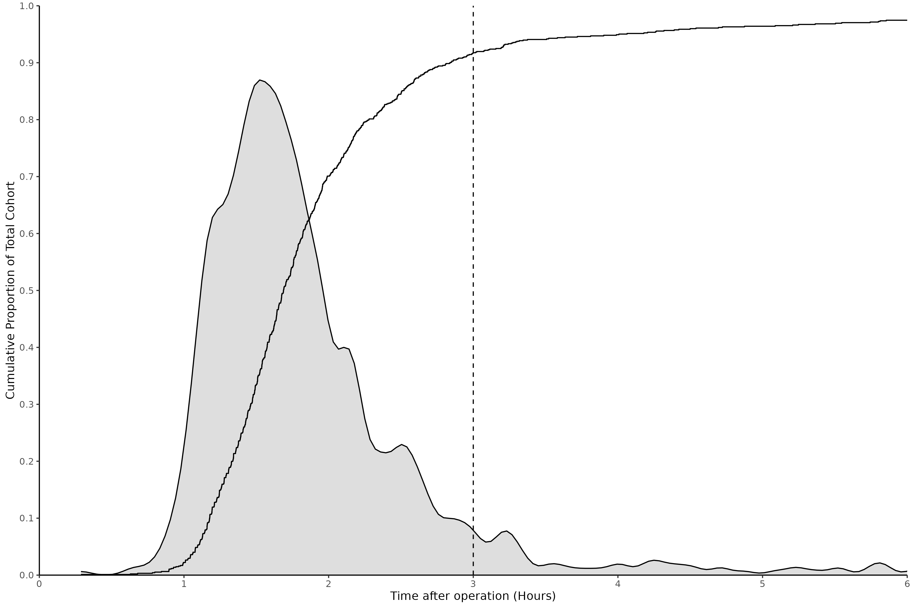
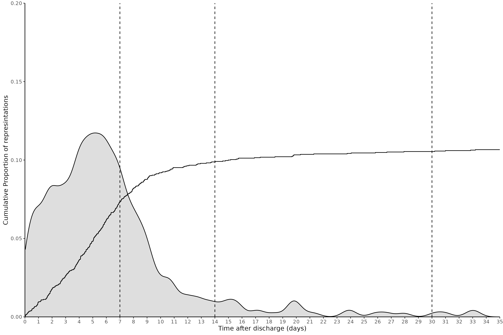
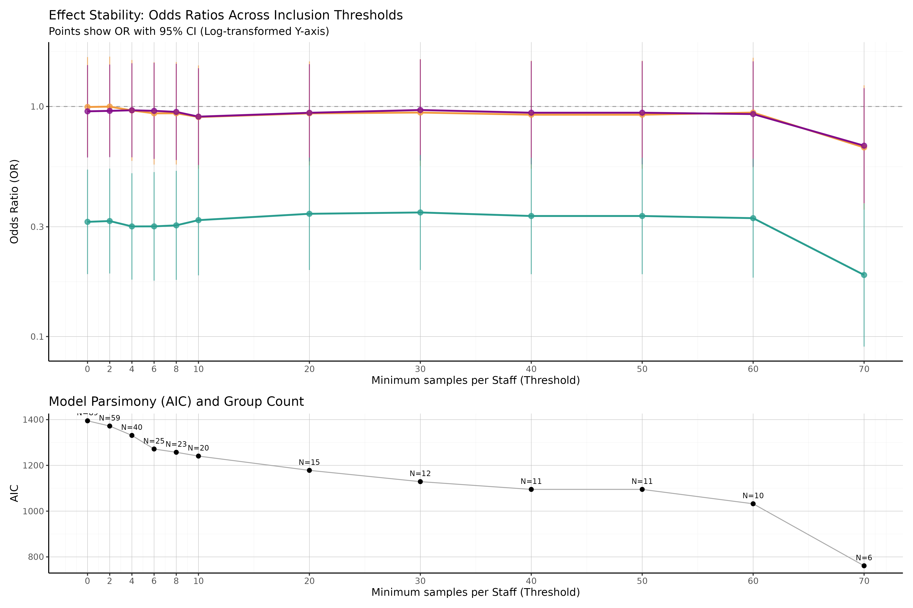

```{r}

library(lme4)
library(broom.mixed)
library(dplyr)
library(ggplot2)
library(arrow)
library(cli)
library(stringr)
library(gt)
library(arrow)
library(tidyr)

source("~/data/dwhitake/tonsillectomy_analgesia/scripts/settings.R")
sapply(functions_paths, source, verbose=FALSE)
df <- readRDS(file=paste0(root_path, "/data/anon_dataset.rds"))

opioid_sensititvity_df <-  readRDS(file=here(root_path, "data/anon_opioid_sensititvity_df.rds"))
readmit_sensititvity_df <-  readRDS(file=here(root_path, "data/anon_readmit_sensititvity_df.rds"))


```

```{r theme setting}

my_theme <- theme_classic(base_size = 12) +
  theme(
    panel.grid.major = element_line(colour = "gray", linewidth = 0.2),
    panel.grid.minor = element_line(colour = "lightgray", linewidth = 0.05)
    # Optional: ensure the panel border matches the linedraw style
    #panel.border = element_rect(colour = "black", fill = NA, linewidth = 0.5)
    )

```

```{r random effects function}

plot_rand_effects <- function(model,cohort_label = "NULL",outcome_label = "NULL", forrest_x_lim = c(0,2), rand_eff_x_lim = c(0.5,1.5), OR=TRUE){
  
  
  if(OR){
rand_effects <- ranef(model) %>% 
  as.data.frame() %>% 
  mutate(
    OR = exp(condval),
    OR_lower = exp(condval - condsd),
    OR_upper = exp(condval + condsd)
  )
  }else{
  rand_effects <- ranef(model) %>% 
  as.data.frame() %>% 
  mutate(
    OR = (condval),
    OR_lower = (condval - condsd),
    OR_upper = (condval + condsd)
  )
}

x_lab <- ifelse(OR, "Odds Ratio (95% CI)", "Estimate (minutes)")

rand_effects_plot <- rand_effects %>% 
  ggplot(aes(x = OR, y = grp)) +  # Swapped x and y for consistency
  geom_point() +
  geom_errorbar(aes(xmin = OR_lower, xmax = OR_upper)) +
  geom_vline(xintercept = 1, linetype = "dashed", alpha = 0.7) +  # Reference line at OR = 1
  theme_minimal() +
  labs(
    subtitle = paste0("Cohort: ", cohort_label, "Outcome: ", outcome_label),  # Consistent with fixed effects
    x = x_lab,  # Consistent terminology
    y = "Provider ID"  # Cleaner label
  )+coord_cartesian(xlim = rand_eff_x_lim)

return(rand_effects_plot)
}

```
```{r}
col_name_lookup<- c("Age (years)" = "age", 
              "Height (cm)" = "Height",
              "Weight (kg)" = "Weight",
              "Age group (count)" = "adult",
              "Gender Identity" = "GenderIdentity",
              "Ethnicity" = "ethnicity_5_group",
              "Procedure Length (minutes)" = "ProcedureLengthMinutes",
              "Specialty" = "specialty",
              "Primary Surgeon (grade)" = "primary_surgeon_grade",
              "Anaesthetic type" = "PrimaryAnesthesiaType",
              "Anaesthetist (grade)" = "first_anaesthesia_grade",
              "ASA physical status" = "AsaPhysicalStatus",
              "Electrocautery" = "electrocautery",
              "Coblation technique" = "coblation",
              "Treatment group" = "treatment_arm",
              "Total encounters (%)" = "Total N (%)",
              
              #EPR PMH
              "Chronic Tonsillitis EPR Diagnosis" = "hx_chronic_tonsillitis",
              "Obstructive Sleep Apnoea EPR Diagnosis" = "hx_sleep_apnoea", 
              "Chronic Pain EPR Diagnosis" = "hx_chronic_pain",
              "Opioid dependance EPR Diagnosis" = "hx_opioid_dependance",
              
              #Intra-op meds 
              "Paracetamol given" = "intra_op_paracetamol_given",
              "Paracetamol (including oral premedications)" = "intra_op_and_pre_paracetamol_given",
              "Diclofenac" = "intra_op_diclofenac_given",
              "Dexamethasone" ="intra_op_dexamethasone_given",
              "Tramadol" = "intra_op_tramadol_given",
              "Clonidine" = "intra_op_clonidine_given",
              "Ketamine" = "intra_op_ketamine_given",
              "Magnesium" = "intra_op_magnesium_given",


              "Total intraoperative opioid dose  (OME, mg)" = "intra_op_ome",
              "Total intraoperative opioid dose  (OME, mg.kg-1)" = "intra_op_ome_per_kg",
              "Intra-operative opioids given" = "intra_op_opioid_given",

              "Morphine" = "intra_op_morphine_sulfate_given",
              "Morphine, Intraoperative Administration, Dose (mg)" = "intra_op_morphine_sulfate_dose",
              "Morphine, Intraoperative Administration, Dose (mg.kg-1)" = "intra_op_morphine_sulfate_dose_per_kg",
              "Oxycodone" ="intra_op_oxycodone_hydrochloride_given",
              "Intra-operative dose of Oxycodone (mg)" = "intra_op_oxycodone_hydrochloride_dose",
              "Fentanyl" ="intra_op_fentanyl_given",
              "Fentanyl, Intraoperative Administration, Dose (µg)" = "intra_op_fentanyl_dose",
              "Fentanyl, Intraoperative Administration, Dose (µg.kg-1)" = "intra_op_fentanyl_dose_per_kg",
              "Diamorphine" ="intra_op_diamorphine_hydrochloride_given",
              "Intra-operative dose of Diamorphine (mg)" = "intra_op_diamorphine_hydrochloride_dose",
              "Buprenorphine" ="intra_op_buprenorphine_given",
              "Alfentanil" = "intra_op_alfentanil_given",
              "Remifentanil" = "intra_op_remifentanil_given",
              
              # Outcomes
              ## Recovery
              "Administration of rescue opioids"="opioid_given_post_op",
              "Administration of rescue morphine" = "opioid_given_post_op_morphine",
              "Administration of rescue fentanyl" = "opioid_given_post_op_fentanyl",
              "Administration of rescue opioids, (OME mg)" = "ome_post_op",
              "Administration of rescue opioids, (OME mg.kg-1)" = "ome_post_op_per_kg",
              "Time in Stage 1 recovery (mins)" = "recovery_time",
              
              ## Returns to theatre
              "Return to theatre within 7 days" = "return_to_theatre_7d",
              "Return to theatre within 14 days" = "return_to_theatre_14d",
              "Return to theatre within 30 days" = "return_to_theatre_30d",
              
              ## Discharge status
              "Died during admission" = "died",
              "Mortality (90 days)" = "mortality_90d",
              "Mortality (1 year)" = "mortality_1y",
              "Alive_at_discharge" = "alive_at_discharge",
              "Length of Stay (days)" = "length_of_admission",
              "Strong opioid perscribed on discharge" = "opioid_on_discharge",
              "Same day discharge" = "same_day_discharge",
              
              ## Discharge meds 
              "Paracetamol on discharge" = "paracetamol_on_discharge",
              "Weak opioid on discharge" = "weak_opioid_on_discharge",
              "New strong opioids on discharge" = "new_opioids_on_discharge",
              "NSAID on discharge" = "nsaid_on_discharge",

              ## ED represintations
              "Represented to ED before 7 days" = "ed_visit_in_7d",
              "Represented to ED before 14 days" = "ed_visit_in_14d",
              "Represented to ED before 30 days" = "ed_visit_in_30d",
              
              "Log std. Surgery length" ="sf_length_x",
              "Log std. Patient age" = "pf_age_x",
              "Log std. Weight"= "pf_weight_x",
              "Pain score at rest 3hrs post-op (Median)" = "pain_score_rest_3hr_post_op_median",
              "Pain score at rest 24hrs post-op (Mean)" = "pain_score_rest_12hr_post_op_median"
              )
```

# Supplementary materials S1 – Data Specification {#sec-sm-data-spec}

## S1.1 - Surgical Procedure Classification

Surgical technique was assessed using the procedure codes recorded for each case using the OPSC-4.9 version as described in **Table S4**
For each case, the procedure was included into a group if one of the eligible OPSC codes was identified (Inclusive of all 3-digit codes within each 2-digit code) and then subsequently removed if an exclusion code was also present.
To exclude concurrent procedures within the mouth where the tonsils may additionally be removed (such as a glossectomy or mandibular resection), the remainder of the F chapter was excluded across the simple procedure groups.
The use of coblation and electrocautery were determined with the same method and then added as a feature to each procedure.
The three surgical groups were checked to ensure mutual exclusivity.

### Table S4 - Criteria for surgical cohort eligability 

| Surgical Group | Eligible OPSC codes | Exclusion OPSC codes |
| :--- | :--- | :--- |
| Tonsillectomy | F34, F35 | E20, F0:F33, F36:F99 |
| Adenoidectomy | E20 | F34, F35, F0:F33, F36:F99 |
| Adenotonsillectomy | F34, F35, E20 | F0:F33, F36:F99, Patients already identified in tonsillectomy and adenoidectomy cohorts. |
| Coblation | Y10.1, F34.7, F35.2 | |
| Electrocautery | Y10.2, Y11.1 | Y10.1 |

Only where a technique is explicitly coded is it auditable.
For example, all ENT procedures are set up with electrocautery (diathermy) as standard, but only in cases where explicit mention is made in the surgical operation note are the coded then captures and auditable.
Thus, surgical technical may be significantly underestimating the true prevalence.

## S1.2 – Past Medical History

For a patient to be considered as ‘positive’ for a previous medical condition their problem list was searched for eligible ICD-10-5th edition codes, where a 3-digit code was provided, this included all of the 4-digit codes inclusive, unless the 4-digit code was provided in the exclusion ICD codes. 

### Table S5 - Eligability for past medical history filtering on ICD10 codes

| Past medical history item | Eligible ICD codes | Exclusion ICD codes |
| :--- | :--- | :--- |
| Chronic Pain | R52 | R52.0 |
| Opioid Dependence | F11 | |
| Chronic Tonsillitis | J35 | J35.8 |
| Sleep apnoea | G47.3 | |

## S1.3 – Intra-operative Medications

Broadly the majority of preparations provided on the intra-operative MAR were intravenous preparations but there are a few examples of oral medications being given.
All medication doses in theatre were converted to mg and if given in discrete doses within a theatre episode where pooled to produce the total intra-operative dose.

### Table S6 - Formulations for interoperative medications

| Medication group (if applicable) | Medication | Medication preparation |
| :--- | :--- | :--- |
| | Paracetamol | paracetamol 1g/100ml solution for infusion, paracetamol 500mg/50ml solution for infusion vial, paracetamol 500mg tablets, paracetamol 500mg suppository, paracetamol 250mg/5ml suspension sugar-free, paracetamol 250mg/5ml oral suspension |
| NSAIDs | Diclofenac* | diclofenac sodium 75mg/3ml injection, diclofenac sodium 100mg suppository, diclofenac sodium 50mg suppository |
| | Dexamethasone | dexamethasone 6.6mg/2ml injection, dexamethasone 2mg tablet |
| | Tramadol | tramadol 100mg/2ml injection |
| | Clonidine | clonidine 150microgram/1ml injection, clonidine 25microgram tablets |
| | Ketamine | ketamine 50mg/5ml injection preservative-free, ketamine 200mg/20ml injection, ketamine 100mg/2mL, ketamine 500mg/10ml injection |
| | Magnesium | magnesium sulfate in 100 ml in normal saline, magnesium sulfate in 250 ml in normal saline |
| Strong opioid | Morphine | morphine sulfate 10mg/1ml solution for injection ampoule, morphine sulfate 1mg/ml injection, morphine sulfate 10mg/5ml oral solution |
| | Oxycodone | oxycodone hydrochloride 10mg/1ml injection, oxycodone hydrochloride 20mg/2ml injection, oxycodone hydrochloride 50mg/1ml injection, oxycodone 100mg/50ml pca solution for infusion, oxycodone hydrochloride 5mg/5ml oral solution sugar-free |
| | Fentanyl | fentanyl 100microgram/2ml injection, fentanyl 2000mcg/100ml pca infusion |
| | Diamorphine | diamorphine hydrochloride 5mg powder for solution for injection, diamorphine hydrochloride 10mg powder for solution for injection |

\* Note: Diclofenac is the only NSAID used within UCLH theatres.
A review of Aspirin, Naproxen, Celecoxib and ibuprofen revealed no intra-operative administrations across the cohort.

## S1.4 – Discharge medications

Discharge medications were counted if there were prescribed on the discharge paperwork, regardless if they were dispensed from hospital pharmacy, sent to the community pharmacy or patients were instructed to purchase over the counter.
Specific formulations of discharge medications have not been provided as clinicians will prescribe a generic medication and dose regime and formulation details are not provided on the discharge paperwork.


### Table S7 - Formulations for discharge medications

| Medication group | Medications generic name |
| :--- | :--- |
| Paracetamol | paracetamol |
| NSAID’s* | Ibuprofen, Diclofenac sodium, Naproxen, Etoricoxib, Celecoxib |
| Strong opioid | morphine sulfate, oxycodone hydrochloride, buprenorphine, fentanyl, diamorphine hydrochloride |
| Weak opioid | codeine phosphate, dihydrocodeine, co-dydramol (dihydrocodeine and paracetamol), co-codamol (codeine and paracetamol), tramadol |
* Aspirin was not included as the primary intention is usually not for post-operative analgesia

\newpage

# Supplementary materials S2 - Missing data

The level of missing data for each of the key variables were assessed as reported in **Table S8**. All other variables had no missing values. Extracted variables for past medical history and medications administered required a past medical history and medication administration record to be able to assess, there was no missing records so these fields have no missing variables. It is noted by the authors the limitations of accuracy of the medical record. Where missing data exists for computed variables there was a missing variable during the computation, hence the resulting value being `NA` (for example if a patient did not have any pain scores recorded within 3 hours post-op the median value is not computable and thus missing).

### Table S8

```{r output=TRUE }

# Define your columns of interest
cols_of_interest <- c(
                      "Height",
                      "Weight",
                      "Sex",
                      "GenderIdentity",
                      "ethnicity_5_group",
                      "AsaPhysicalStatus",
                      "intra_op_fentanyl_dose",
                      "intra_op_fentanyl_dose_per_kg",
                      "intra_op_morphine_sulfate_dose",
                      "intra_op_morphine_sulfate_dose_per_kg",
                      "intra_op_ome",
                      "treatment_arm",
                      "ome_post_op",
                      "recovery_time",
                      "pain_score_rest_3hr_post_op_median",
                      "mortality_90d",
                      "mortality_1y")

# Calculate missingness
missing_summary <- df %>%
  mutate(across(all_of(cols_of_interest), as.character)) %>%
  select(adult, all_of(cols_of_interest)) %>%
  pivot_longer(
    cols = all_of(cols_of_interest), 
    names_to = "variable", 
    values_to = "value"
  ) %>%
  group_by(variable, adult) %>%
  summarise(na_count = sum(is.na(value)), .groups = "drop") %>%
  pivot_wider(
    names_from = adult, 
    values_from = na_count,
    names_prefix = "temp_"
  ) %>%
  rename(paediatric = temp_0, adult = temp_1) %>%
  mutate(adult_percent = adult / nrow(df%>%filter(adult==1)),
         paediatric_percent = paediatric / nrow(df%>%filter(adult==0)))

ordered_summary <- missing_summary %>%
  mutate(variable = factor(variable, levels = cols_of_interest)) %>%
  arrange(variable)

totals <- data.frame(variable = "Total count", adult = nrow(df%>%filter(adult==1)), adult_percent = NA,  paediatric = nrow(df%>%filter(adult==0)), paediatric_percent = NA)

missing_data <- rbind(totals, ordered_summary)

matches <- match(missing_data$variable, col_name_lookup)
missing_data$variable[!is.na(matches)] <- names(col_name_lookup)[matches[!is.na(matches)]]

gt(missing_data) %>%
  tab_spanner(
    label = "Adults",
    columns = c(adult, adult_percent)
  ) %>%
  tab_spanner(
    label = "Paediatrics",
    columns = c(paediatric, paediatric_percent)
  ) %>%
  
  # 4. Rename columns within the groups
  
  # 5. Format percentages to 2 decimal places
  fmt_percent(
  columns = c(adult_percent, paediatric_percent),
    decimals = 2
  ) %>%
  
  # 6. Handling the 'Total count' row (Optional: bolding the first row for emphasis)
  tab_style(
    style = cell_text(weight = "bold"),
    locations = cells_body(rows = 1)
  ) %>%
  
  # Clean up missing values (e.g., for Total count percentages)
  sub_missing(
    columns = everything(),
    missing_text = "---"
  ) %>%
    cols_label(
    adult = "Count",
    adult_percent = "Percentage (%)",
    paediatric = "Count",
    paediatric_percent = "Percentage (%)"
  ) 

```

\newpage

# Supplementary materials S3 - Oral Morphine Equivalence

For each medication the routes were grouped and a conversion value attributed using the standard equivalence table provided by Neilsen et al.
Oral morphine equivalence (OME) was then calculated as a weighted sum using the standard OME equation.
$$
\begin{aligned}
&\text{for}\  i \in \{1,...,n\}\\
\text{OME} &= d_{\text{ref}} + \sum_{i \in N} (c_i  d_i)\\
\\
&&d_{\text{ref}} = \text{dose of reference medication} \\
&&d_{i} = \text{dose of medication} \\
&&c_{i} = \text{conversion value of medication} \\
&&{N} = \text{non-referance medications}
\end{aligned}
$$
Distributions and mean dose sum of each opioid within each treatment group are described within the results.

\newpage

# Supplementary materials S3 - Analysis code

Data was extracted from the EPR and stored in a proprietary data model in the parquet format. Extraction code is not provided as it contains intellectual property of the EPR provider Epic, Wisconsin.

The dataset was cleaned to remove known issues by the script `import_proccess.qmd`.

The tonsillectomy dataset was produced by the script `peri_op_med_dataset.qmd`.

The analysis was performed by the script `peri_op_med_analysis.qmd` and supplementary analysis and materials in `peri_op_med_supp_mat.qmd`. 


The code is held at the following github repository [https://github.com/DW10/tonsillectomy_analgesia](https://github.com/DW10/tonsillectomy_analgesia)

\newpage

# Supplementary materials S4 – Sensitivity analysis

## S4.1 – Rescue opioid administration


```{r}


cutoffs <- seq(0.5,6,0.5)
n_total_patients <- length(unique(opioid_sensititvity_df$EncounterKey))

# Calculate proportion for each time point
rescue_opioid_prop_table <- data.frame(
  Hours = cutoffs,
  N_Patients = sapply(cutoffs, function(t) {
    length(unique(opioid_sensititvity_df$EncounterKey[opioid_sensititvity_df$med_time <= t*60]))
  }),
   Proportion_of_reciving = sapply(cutoffs, function(t) {
    round((length(unique(opioid_sensititvity_df$EncounterKey[opioid_sensititvity_df$med_time <= t*60])) / length(unique(opioid_sensititvity_df$EncounterKey[!is.na(opioid_sensititvity_df$med_time)])))*100, 2)
  }),
    Proportion = sapply(cutoffs, function(t) {
    round((length(unique(opioid_sensititvity_df$EncounterKey[opioid_sensititvity_df$med_time <= t*60])) / n_total_patients)*100, 2)
  })
)

sens_analysis_rescue <- rescue_opioid_prop_table %>% gt() %>%
  tab_header(
    title = "Sensitivity analysis for Rescue opioid administration",
  ) %>%
  cols_label(
    Hours = "Time (hours)",
    N_Patients = "Patients receiving 1 or more doses (N)",
    Proportion_of_reciving = "Proportion of patients who received an opioid (%)",
    Proportion = "Proportion of all patients (%)"
  ) 


gtsave(sens_analysis_rescue, file=paste0(root_path, "/export/table_S9.docx" ))

recovery_time_cutoff <- 3

# 1. Calculate the total number of unique patients (the denominator)
total_n <- n_distinct(opioid_sensititvity_df$EncounterKey)

# 2. Create a summary dataframe for the ECDF line
ecdf_data <- opioid_sensititvity_df %>%
  filter(!is.na(med_time)) %>%
  arrange(med_time) %>%
  mutate(
    time_hours = med_time / 60,
    # Calculate proportion based on the TOTAL cohort, not just those with meds
    cumulative_prop = row_number() / total_n 
  )

sens_analysis_rescue_plot <- ggplot(opioid_sensititvity_df, aes(x=med_time/60))+
  geom_density(fill="gray", alpha = 0.5, adjust=0.5, na.rm = TRUE)+
  geom_step(data = ecdf_data, aes(x = time_hours, y = cumulative_prop))+
  labs(
    x = "Time after operation (Hours)",
    y = "Cumulative Proportion of Total Cohort"
  ) +
  scale_x_continuous(breaks = seq(0, 6, by = 1), expand = c(0, 0)) +
  scale_y_continuous(breaks = seq(0, 1, by = 0.1), limits = c(0, 1), expand = c(0, 0)) +
  geom_vline(xintercept = recovery_time_cutoff, linetype = 2) +
  theme_classic() +
  theme(legend.position = "none") +
  coord_cartesian(xlim = c(0, 6), ylim = c(0, 1))

ggsave(plot=sens_analysis_rescue_plot, device="png", file=paste0(root_path, "/export/figure_S6.png"), width=12, height=8 )


```

The time to first post-operative opioid was extracted for all patients, and a sensitivity analysis was performed to establish the best cut off time as show in the **Table S9** and **Figure S6**.
A threshold time of 3 hours was selected given the clinical rational of any inter-operative analgesia plan would include adequate analgesic for this period and any opioids administered within 3 hours would represent inadequate analgesic effect.

### Table S9
```{r}
#| output: true
sens_analysis_rescue
```

### Figure S6 - Cumulative density of opioid administration times in recovery



*Cumulative density plot of the administration times of opioid medications from the end of surgery to the first dose given for patient that received an opioid within 6 hours of surgery. Gray filled area depicts the density distribution and dotted line denotes the time cut off point of 3 hours. *

\newpage


## S4.2 – Presentation to the emergency department


```{r}

cutoffs <- c(1,2,3,4,5,6,7,14,30, 35)
n_total_patients <- length(unique(df$EncounterKey))

# Calculate proportion for each time point
prop_table <- data.frame(
  Days = cutoffs,
  N_Patients = sapply(cutoffs, function(t) {
    length(unique(readmit_sensititvity_df$index_encounter_key[readmit_sensititvity_df$readmit_time <= t]))
  }),
   Proportion_of_readmitted = sapply(cutoffs, function(t) {
    round((length(unique(readmit_sensititvity_df$index_encounter_key[readmit_sensititvity_df$readmit_time <= t])) / length(unique(readmit_sensititvity_df$index_encounter_key[!is.na(readmit_sensititvity_df$readmit_time)])))*100, 2)
  }),
    Proportion_of_all = sapply(cutoffs, function(t) {
    round((length(unique(readmit_sensititvity_df$index_encounter_key[readmit_sensititvity_df$readmit_time <= t])) / n_total_patients)*100, 2)
  })
)

sens_analysis_ed <- prop_table %>% gt() %>%
  cols_label(
    Days = "Time (Days)",
    N_Patients = "Patients attending the emergency department (N)",
    Proportion_of_readmitted  = "Proportion of patients who presented within 35 days (%)",
    Proportion_of_all = "Proportion of all patients (%)"
  ) 

gtsave(sens_analysis_ed, file=paste0(root_path, "/export/table_S10.docx" ))

readmit_time_cutoff <- c(7,14,30)

total_n <- n_distinct(df$EncounterKey)

#readmit_sensititvity_df <- readmit_sensititvity_df %>% full_join(df %>% select(EncounterKey) %>% rename(index_encounter_key  = EncounterKey))

# 2. Create a summary dataframe for the ECDF line
ecdf_data <- readmit_sensititvity_df %>% ungroup() %>%
  filter(!is.na(readmit_time)) %>%
  arrange(readmit_time) %>%
  mutate(
    time_hours = readmit_time,
    # Calculate proportion based on the TOTAL cohort, not just those with meds
    cumulative_prop = row_number() / total_n 
  )

readmit_time_cutoff <- c(7,14,30)

sens_analysis_readmit_plot <- ggplot(readmit_sensititvity_df, aes(x=readmit_time))+
  geom_density(fill="gray", alpha = 0.5, adjust=0.5, na.rm = TRUE)+
  geom_step(data = ecdf_data, aes(x = time_hours, y = cumulative_prop))+
  labs(
    x = "Time after discharge (days)",
    y = "Cumulative Proportion of represintations"
  ) +
  scale_x_continuous(breaks = seq(0, 35, by = 1), expand = c(0, 0)) +
  scale_y_continuous(breaks = seq(0, 1, by = 0.05), limits = c(0, 1), expand = c(0, 0)) +
  geom_vline(xintercept = readmit_time_cutoff, linetype = 2) +
  theme_classic() +
  theme(legend.position = "none") +
  coord_cartesian(xlim = c(0, 35), ylim = c(0, 0.2))

ggsave(plot=sens_analysis_readmit_plot, device="png", file=paste0(root_path, "/export/figure_S7.png"), width=12, height=8 )

# hand_audit_ed_presintations <- df %>% filter(ed_visit_in_30d == 1) %>% select(PatientDurableKey, Date, EndInstant, adult, cohort) %>% left_join(readmit_sensititvity_df %>% group_by(PatientDurableKey)%>% slice_min(readmit_time)) %>% left_join(patient_key_mapping %>% collect(), join_by(PatientDurableKey == AnonymizedKey)) %>% mutate(PatientDurableKey = OriginalKey) %>% select(-INDEX, -OriginalKey)
# 
# hand_audit_ed_presintations$audit <- NA
# 
# hand_audit_ed_presintations$audit[sample(nrow(hand_audit_ed_presintations), 50)] <- 1

#write_csv(hand_audit_ed_presintations, "/data/ed_visits.csv")

```


All of the subsequent presentations to the UCLH emergency department within 35 days was extracted for the patients.
Primary reason for attendance was not extracted and where patients attended more than once within the 40 day period the first presentation was used.
A sensitivity analysis was performed to understand the distribution of the data against the clinically benchmarked timepoints of 7, 14 and 30 days.
The table below and figure S2 depicts the proportion of presentations across important timepoints.


### Table S10

```{r}
#| output: true
sens_analysis_ed
```


### Figure S7 - Cumulative density of time to presentation to the emergency department


*Cumulative density plot of the of the time to presentation at the emergency department (ED) from the discharge date to the ED visit time. Gray filled area depicts the density distribution and dotted line denotes the time point of 7,14 and 30 days.*

## S4.3 – Multi-level modelling group size threshold

```{r sensatitivty for anaesthis cases cut off}

library(purrr)
library(dplyr)
library(lme4)

# Define range of thresholds to test
thresholds <- c( seq(0,8, 2), seq(10,70, 10))

sensitivity_results <- map_df(thresholds, function(t) {
  
  # 1. Subset data based on group size
  df_sub <- df %>% filter(adult==1) %>%
    group_by(FirstAnesthesiaProviderDurableKey) %>%
    filter(n() >= t) %>%
    ungroup()
  
  # 2. Fit model with error handling
  mod <- tryCatch({
    glmer(opioid_given_post_op ~ treatment_arm + (1 | FirstAnesthesiaProviderDurableKey),
          data = df_sub, 
          family = binomial(link = "logit"),
          control = glmerControl(optimizer = "bobyqa"))
  }, error = function(e) return(NULL))
  
  # 3. Extract metrics if model succeeded
  if (!is.null(mod)) {
    # Get all fixed effects
    fe <- fixef(mod)
    
    # Identify the treatment arm coefficient (excluding Intercept)
    # This assumes treatment_arm has 2 levels; adjust if multi-level
    arm_index <- grep("treatment_arm", names(fe))
    
    data.frame(
      threshold = t,
      n_obs = nrow(df_sub),
      n_providers = n_distinct(df_sub$FirstAnesthesiaProviderDurableKey),
      beta_arm_2 = fe[arm_index[1]], # Captures the first non-baseline level
      beta_arm_3 = fe[arm_index[2]],
      beta_arm_4 = fe[arm_index[3]],
      se_arm_2 = sqrt(diag(vcov(mod)))[arm_index[1]],
      se_arm_3 = sqrt(diag(vcov(mod)))[arm_index[2]],
      se_arm_4 = sqrt(diag(vcov(mod)))[arm_index[3]],
      var_staff = as.data.frame(VarCorr(mod))$vcov[1],
      aic = AIC(mod),
      converged = is.null(mod@optinfo$conv$lme4$messages),
      row.names = NULL
    )
  } else {
    data.frame(threshold = t, n_obs = nrow(df_sub), beta_arm = NA, converged = FALSE)
  }
})

print(sensitivity_results)

sens_analysis_multi_level_theshold <- sensitivity_results %>% gt() %>%
  cols_label(
    threshold = "Theshold value",
    n_obs  = "Patients included (N)",
    n_providers   = "Clinicans included (N)",
    beta_arm_2  = "2",
    beta_arm_3  = "3",
    beta_arm_4  = "4",
    se_arm_2  = "2",
    se_arm_3  = "3",
    se_arm_4  = "4",
    var_staff = "Variance from Clinician",
    aic = "AIC",
    converged = "Model convergence"
  ) %>%
  tab_spanner(
    label = "Beta of Treatment group (Log Odds)",
    columns = c(beta_arm_2, beta_arm_3, beta_arm_4),
  ) %>%
  tab_spanner(
    label = "Standard Error of Treatment group",
    columns = c(se_arm_2, se_arm_3, se_arm_4),
  )%>% fmt_number(decimals = 2)

gtsave(sens_analysis_multi_level_theshold, file=paste0(root_path, "/export/table_S11.docx" ))

```

```{r plotting of multi-level theshold}
sensitivity_long <- sensitivity_results %>%
  pivot_longer(
    cols = starts_with("beta_arm_") | starts_with("se_arm_"),
    names_to = c(".value", "arm_id"),
    names_sep = "_arm_"
  )%>%
  mutate(
    or = exp(beta),
    or_low = exp(beta - 1.96 * se),
    or_high = exp(beta + 1.96 * se)
  )

library(ggplot2)
library(patchwork) # For combining plots

# 1. Plot Effect Stability (Beta with 95% CI)
p1 <- ggplot(sensitivity_long, aes(x = threshold, y = or, color = arm_id, group = arm_id)) +
  # Reference line at OR = 1 (Null effect)
  geom_hline(yintercept = 1, linetype = "dashed", color = "black", alpha = 0.3) +
  geom_line(size = 1, show.legend = FALSE) +
  geom_pointrange(aes(ymin = or_low, ymax = or_high), 
                  show.legend = FALSE, alpha = 0.7) +
  # Log scale for Y is standard for Odds Ratios to maintain symmetry
  scale_y_log10() +
  scale_x_continuous(breaks = thresholds)+
  scale_color_manual(values = colour_pallet[2:4]) +
  labs(
    title = "Effect Stability: Odds Ratios Across Inclusion Thresholds",
    subtitle = "Points show OR with 95% CI (Log-transformed Y-axis)",
    x = "Minimum samples per Staff (Threshold)",
    y = "Odds Ratio (OR)"
  ) +
  my_theme
  
p2 <- ggplot(sensitivity_results, aes(x = threshold, y = aic)) +
  geom_line(color = "darkgrey") +
  geom_point(size = 2) +
  geom_text(aes(label = paste0("N=", n_providers)), vjust = -1, size = 3) +
  scale_x_continuous(breaks = thresholds)+
  labs(
    title = "Model Parsimony (AIC) and Group Count",
    x = "Minimum samples per Staff (Threshold)",
    y = "AIC"
  ) +
  my_theme

# Combine plots
combined_plot <- (p1 / p2) + plot_layout(heights = c(2, 1))
print(combined_plot)

ggsave(plot = combined_plot, paste0(root_path,"/export/figure_S8.png"), height=8, width=12, scale = 1.2)

```


To account for inter-clinician difference in practices, multi-level modelling has been used.
To balance the power of the model against the generalisability a threshold of case size has been used.

Clinicians who have performed fewer than 5 cases for adult patients across the whole study period were deemed not experienced enough to impart personalised differences in practice to the care and thus were removed from the modelling.

A threshold of 5 was chosen from the sensitivity **Table S11** and **Figure S8**.

The maximum threshold values test was 70 due to failure of model convergence beyond this value.

### Table S11

```{r}
#| output: true

sens_analysis_multi_level_theshold

```

*Table of model performance of the unadjusted multilevel model of primary outcome (rescue opioids) with varying threshold levels*

### Figure S8 - Plot of sensativity analysis of mutli-level threshold



*Upper plot, line chart of odds ratio with 95% confidence interval bands for differing clinical group size threshold values.Lower plot, line chart of AIC over threshold values with number of clinicians included shower per point.*
\newpage

# Supplementary materials S5 – Modelling

## Directed Acyclic Graph 

A direct acyclic graph was generated using expert domain konwledge to understand and specific the suitable co-variants for the associational model. 

```{mermaid}
%%| label: fig-workflow
%%| fig-cap: "A simple workflow diagram showing step A leading to step B."

flowchart LR
    classDef dashedNode stroke-dasharray: 5 5

    AT>Anaesthetic Technique]
    TIVA((TIVA))
    MD((Morphine Dose))
    FD((Fentanyl Dose))
    WT((Weight))
    HT((Height))
   
    OC((Previous Opioid use))
    ETH(Ethnicity)
    OAC((Opioid Concentration)):::dashedNode
    SE((Surgeon Exp))
    SS((Surgical Skill)):::dashedNode
    SI((Surgical Site))
    SHD((Surgical Harm Damage)):::dashedNode
    COB((Coblation))
    LOSurg((Length of Surgery))
    SED((Sedation)):::dashedNode
    NAU((Nausea)):::dashedNode
    PAIN((Pain)):::dashedNode
    TOD(Time of day)
    ON[Overnight Stay]
    LOS[LOS]
    LIR[Length in Recovery]
    RR[Rescue analgesia]
    RD((Remifentanil Dose))
    PD((Propofol dose))

    subgraph PV[Patient Variables]
        WT((Weight))
        HT((Height))
        ETH(Ethnicity)
        OC
    end


    subgraph PV2[Anaesthesia Variables]
    TIVA
    MD
    FD
    RD
    RD
    end

      subgraph PV3[Surgical Variables]
    SS
    SI
    SE
    SHD
    COB
    LOSurg
    end

    AT --> TIVA
    AT --> MD
    AT --> OAC

    TIVA --> RD
    RD --> OAC
    TIVA --> PD
    PD --> SED

    MD --> OAC
    FD --> OAC
    WT --> OAC
    HT --> OAC
    OC --> OAC
    ETH --> OAC
    OAC --> SED
    OAC --> NAU
    OAC --> PAIN
    SE --> SS
    SS --> SHD
    SI --> SHD
    COB --> SHD
    LOSurg --> SHD
    SHD --> PAIN
    PAIN --> RR
    RR --> LIR
    SED --> LOS
    SED --> LIR
    NAU --> LOS
    NAU --> LIR
    TOD ---> ON
    LOS --> ON


```

## S5.1 – Models parameters

### Table S12

| Model Number | Cohort | Outcome | Multi-level by primary anaesthetist | Co-variants | Notes |
| :--- | :--- | :--- | :--- | :--- | :--- |
| 0 | Adult | Recovery opioids | No | Nil | |
| 1 | Adults | Recovery opioids | Yes | Nil | |
| 2 | Adults | Recovery opioids | Yes | age, sex, surgical cohort, ASA, history of chronic pain, procedure length and use of coblation | |
| 3 | Adults | Time in recovery | Yes | | |
| 4 | Adults | Same discharge | Yes | | |
| 5 | Adults | Opioid on discharge | Yes | | Model fails to converge |
| 6 | Adults | Return to ED at 7 days | Yes | | Model fails to converge |

The following secondary outcomes were not modelled with the associated justification:

 -  Length of admission (Days) – Same day discharge has been modelled as a logistic regression instead due to the multi-modal disruption of length of admission.
 
-  Median pain score – Significant number of missing data as pain scores not being collected in recovery, only on the ward.

-  Discharge medications – Medication prescriptions at the point of discharge likely represent the variation in discharging clinician rather than anaesthetic clinician

-  Return to theatre– Lack of distribution of outcome

-  Re-presentation – Lack of distribution of outcome

- Deaths – Lack of distribution of outcome

## S5.2 Multilevel modelling

An ANOVA was performed between model 0 (without multi-level modelling) and model 1 (with multi-level modelling) to establish the difference in model performance

### Table S13 - ANOVA of Model 0 and Model 1

```{r}
#| output: true

model_save <- readRDS(paste0(root_path, "/data/models.rds"))

models <- model_save[[1]]

model_0 <- models[[1]]
model_1 <- models[[2]]
model_2 <- models[[3]]
model_3 <- models[[4]]
model_4 <- models[[5]]
model_5 <- models[[6]]
model_6 <- models[[7]]

gt_tables <- model_save[[3]]

multi_level_anova <- anova(model_1, model_0) 

multi_level_anova %>% gt()

multi_level_anova %>% gt() %>%
gtsave(file=paste0(root_path, "/export/table_S13.docx" ))

```

\newpage

## S5.3 - Results of Model 1

In Model 1 the variance explained by the anaesthetist ID was `r data.frame(VarCorr(model_1)) %>% pull(vcov) %>% scales::percent(accuracy = 0.1)`

### Table S14 - Fixed effects of model 1
```{r}
#| output: true
gt_tables[[1]]
```

### Figure S9 - Random effects of model 1

```{r}
#| output: true
#| fig-width: 6
#| fig-height: 3

plot_rand_effects(model_1, outcome_label = "Recovery opioids", cohort = "Adult (unadjusted) ")

```

\newpage

## S5.4 - Results of Model 2

In Model 1 the variance explained by the anaesthetist ID was `r data.frame(VarCorr(model_2)) %>% pull(vcov) %>% scales::percent(accuracy = 0.1)`

### Table S16 - Fixed effects of model 2
```{r}
#| output: true
gt_tables[[2]]
```

### Figure S10 - Random effects of model 2

```{r}
#| output: true
plot_rand_effects(model_2, outcome_label = "Recovery opioids", cohort = "Adult (adjusted) ")

```
\newpage

## S5.4 - Results of Model 3

In Model 3 the standard deviation of the variance explained by the anaesthetist ID was `r data.frame(VarCorr(model_3))[1,] %>% pull(sdcor) %>% round(digits=2) ` minutes.

### Table S17 - Fixed effects of model 3
```{r}
#| output: true
gt_tables[[3]]
```

### Figure S11 - Random effects of model 3

```{r}
#| output: true
plot_rand_effects(model_3, outcome_label = "Time in recovery (minutes)", cohort = "Adult (unadjusted) ", OR = FALSE, rand_eff_x_lim = c(-5, 5))

```
\newpage

## S5.5 - Results of Model 4

In Model 4 the variance explained by the anaesthetist ID was `r data.frame(VarCorr(model_4)) %>% pull(vcov) %>% scales::percent(accuracy = 0.1)`

### Table S18 - Fixed effects of model 4
```{r}
#| output: true
gt_tables[[4]]
```

### Figure S12 - Random effects of model 4

```{r}
#| output: true
plot_rand_effects(model_4, outcome_label = " Same day discharge", cohort = "Adult (adjusted) ", rand_eff_x_lim = c(0, 2.5))

```
\newpage

## S5.3 - Results of Model 5

In Model 5 the variance explained by the anaesthetist ID was `r data.frame(VarCorr(model_5)) %>% pull(vcov) %>% scales::percent(accuracy = 0.1)`

### Table S19 - Fixed effects of model 5
```{r}
#| output: true
gt_tables[[5]]
```

### Figure S13 - Random effects of model 5

```{r}
#| output: true
plot_rand_effects(model_5, outcome_label = " Opioids on discharge", cohort = "Adult (adjusted) ")

```
\newpage

## S5.3 - Results of Model 6

In Model 6 the variance explained by the anaesthetist ID was `r data.frame(VarCorr(model_6)) %>% pull(vcov) %>% scales::percent(accuracy = 0.1)`

### Table S20 - Fixed effects of model 6
```{r}
#| output: true
gt_tables[[6]]
```

### Figure S14 - Random effects of model 6

```{r}
#| output: true
plot_rand_effects(model_6, outcome_label = " Presintation to emergency department within 7 days", cohort = "Adult (adjusted) ")

```


